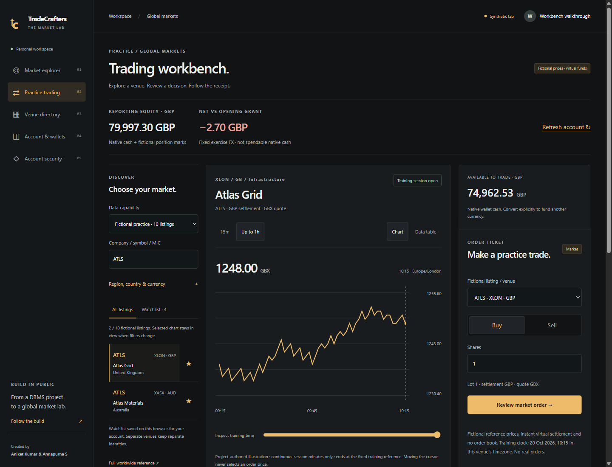

# TradeCrafters

[](https://github.com/DuhItzAniket/TradeCrafters/actions/workflows/foundation.yml)

**A global paper-trading laboratory built with Next.js, TypeScript and MySQL.** Originally created by **Aniket Kumar and Annapurna S** for a DBMS course, now being rebuilt around trustworthy accounts, explicit market coverage and a purposeful trading interface.

[Get started](#run-locally) · [Architecture](docs/architecture/README.md) · [Roadmap](docs/ROADMAP.md) · [Contributing](CONTRIBUTING.md) · [Security](SECURITY.md)

The M1 foundation, M2 accounting and **M3 workbench implementation** are available in `apps/web` and `packages/`. Explore a **2,889-record worldwide MIC reference**, practice with ten fictional listings across six regions, and follow native holdings, explicit FX and persistent receipts on MySQL. The workbench combines venue-qualified discovery, an authored training chart and a native-currency ticket. [Implementation and evidence](docs/implementation/workbench.md). **M3 remains open for real student walkthroughs**; real-data integration and public deployment remain later milestones. Directory presence is not verified exchange trading coverage.



## Current capabilities

| Capability                                                     | Status                                                       |
| -------------------------------------------------------------- | ------------------------------------------------------------ |
| Responsive global explorer and disambiguated exchange listings | Working with fictional scenarios                             |
| Worldwide MIC reference search, filters and pagination         | 2,889 dated records; cash-equity classification remains open |
| Immutable reference versions/diffs and dated provider aliases  | Audited operator workflow; all real coverage stays unknown   |
| Server sessions, ownership checks and native-currency wallets  | Working locally with MySQL                                   |
| GitHub OAuth                                                   | Local callback and reload verified; production HTTPS pending |
| Authenticator, admin roles and audited funding pause           | Working locally; explicit operator provisioning required     |
| Versioned calendars, lots, ticks, bands and permission checks  | Ten fictional policies; real-market simulation disabled      |
| Native buy/sell, exact basis/P&L and balanced cash journals    | Working with server-owned fictional quotes and venue rules   |
| Explicit virtual FX and reporting valuation                    | Working across twelve currencies; fixed exercise rates       |
| Durable receipts, retry recovery and archive/reset history     | Working locally; verified with MySQL races and process death |
| Chart workbench, watchlists and real-venue coverage states     | Working locally; observed student walkthroughs pending       |
| Real exchange data and public deployment                       | Coverage, licensing and operational gates pending            |

## Run locally

Requires Node **24.22.0 LTS**, npm and Docker Desktop/Engine.

```sh
npm ci
npm run setup:local
docker compose --env-file .env.local up -d --wait
npm run db:migrate
npm run db:seed
npm run setup:db-identities
npm run dev
```

Open **http://127.0.0.1:3000**. Setup creates fresh ignored local credentials and separates the restricted web database identity from operator tooling. Local sign-up uses made-up test details; this mode is explicitly blocked in production. No market-data API key is required.

Choose a reporting currency under **Account & wallets**, then open **Practice trading**. Search/filter a venue-qualified listing, inspect the chart or exact-price table, and review a native-currency order. Charts are project-authored illustrations ending at a fixed training clock; execution uses a separate fresh server quote. Convert cash explicitly in **Wallets & FX** before buying in another currency. If a response is lost, recover its receipt before submitting another operation. Selecting an unconnected real venue shows its coverage gaps and no order ticket.

See the [complete setup and environment contract](docs/implementation/local-development.md), [trading/accounting contract](docs/implementation/trading-accounting.md), [admin/security runbook](docs/implementation/admin-security.md), [catalog operator workflow](docs/implementation/catalog-operations.md), [market policies](docs/implementation/market-policies.md), and [current status](docs/implementation/foundation-status.md). Acceptance evidence: [M1](docs/implementation/m1-acceptance.md), [M2](docs/implementation/m2-acceptance.md). The [project logo](apps/web/public/brand/tradecrafters-mark.png) is available for the GitHub OAuth app avatar.

## Project layout

| Path                      | Purpose                                                                              |
| ------------------------- | ------------------------------------------------------------------------------------ |
| `apps/web`                | Next.js + React explorer, trading desk, identity and same-origin APIs                |
| `packages/domain`         | Exact currency/quote-unit arithmetic, fill/FX models, basis and calendar rules       |
| `packages/contracts`      | Strict request validation                                                            |
| `packages/database`       | MySQL queries, authentication adapter, checked-in SQL migrations                     |
| `packages/market-catalog` | Dated worldwide MIC reference and separate fictional scenarios                       |
| `tests`                   | Domain and real HTTP/MySQL integration checks                                        |
| `docs`                    | Audit, provider research, global architecture, roadmap, design and execution records |
| `client`, `server`, `sql` | Preserved legacy coursework, separate from the new app                               |

## Direction and tracking

The scope is **stock exchanges worldwide**, including smaller and frontier markets. Global venue/listing identity and native currencies are part of the foundation. Real data will be enabled by verified provider coverage, permitted use and market-rule readiness; no universal free live feed is promised.

Start with the [research index](docs/README.md), [global architecture](docs/architecture/global-markets.md), [market-data comparison](docs/research/02-market-data.md), [roadmap](docs/ROADMAP.md), and [GitHub tracker #2](https://github.com/DuhItzAniket/TradeCrafters/issues/2).

The new workspace pins a supported stack, runs on Node 24, and emits a production build with a Vercel/Node-container path. A hosted MySQL database and registered OAuth application still need configuration and verification. No billable resource has been provisioned.

## Engineering workflow

Changes land through pull requests to protected `main`. Auto-merge is available for authorized PRs once the required `verify` check passes, the branch is up to date, and review conversations are resolved. The check covers tracked-source/credential patterns, clean installation, MySQL migrations and seed, restricted web DB provisioning, type/lint/format, **44 domain/configuration and 72 integration checks**, a dependency audit, and a production build.

Read the [contribution guide](CONTRIBUTING.md), [security policy](SECURITY.md), [change history](CHANGELOG.md), and [local setup guide](docs/implementation/local-development.md) before making a change. Project status distinguishes verified behavior from work still on the roadmap.

## Legacy project

The original code remains available for reference. Its [audit](docs/research/01-current-state-audit.md) records authentication, accounting, setup and data-freshness gaps. Do not deploy the old server alongside the new app or reuse historical credentials. The [archived coursework README](docs/legacy-coursework-readme.md) preserves the original description; its live-data/JWT claims are historical intentions, not verified v2 behavior.
