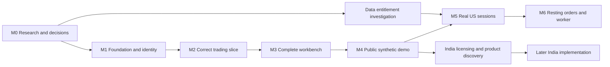

# Implementation roadmap

**Planning baseline:** 20 October 2026. Scope is US first, India later; personal portfolio project with a near-free first deployment. Estimates are focused contributor-days, not deadlines or promises. Re-estimate after the first working slice.

## Milestones and dependencies

The primary release is **M4**. It remains useful even if an affordable public real-data agreement never materializes. Data entitlement investigation can proceed alongside implementation without blocking synthetic mode. Workers, India, and competitions do not belong on M4's critical path.

| Milestone | Indicative effort | Deliverable | Exit criteria |
| --- | --- | --- | --- |
| **M0 — Research** | Completed in this documentation change | Audit, sources, architecture alternatives, domain rules, design study, GitHub plan | Review proposal; record approvals/changes in ADRs. Documentation does not mark code vulnerabilities fixed. |
| **M1 — Reproducible foundation and identity** | 4–6 days | Additive TypeScript app, one migration history, local MySQL, supported auth, contracts, CI foundation | Fresh clone can start from documented commands; real sign-up/sign-in/out works; session revocation and cross-account denial verified; no imported secrets or reliance on ignored source files. |
| **M2 — Correct trading vertical slice** | 5–8 days | Synthetic quote → order → fill/journal → positions/receipt | Server owns identity and pricing; exact arithmetic; unique idempotency; single-connection transactions; same-account concurrent tests preserve balances/inventory; all ledger assertions pass. |
| **M3 — Designed workbench** | 5–8 days | Responsive chart/watchlist/ticket/positions/activity with complete states | Student walkthroughs, keyboard/mobile check, receipt and timeout recovery flows, honest labels, consistent updates after fills; no unimplemented trading controls. |
| **M4 — Deploy and harden the public synthetic demo** | 3–5 days | Vercel + managed MySQL deployment and runbook | Isolated preview/CI data; TLS/least privilege; persistent abuse controls; sanitized logs; clean secret/dependency review; backup restore drill; measured load/connection budget; readme and creator credits. |
| **M5 — Entitled US real-market sessions** | 3–6 days plus provider lead time | One adapter and capped universe with calendar/freshness behavior | Written scope approval; quota tests; real-vs-synthetic separation; stale/closed/halt failures; raw/adjusted semantics; session reset restriction or tested corporate actions for multi-day positions. |
| **M6 — Durable orders/learning extensions** | 5–10+ days, scoped separately | Worker and DAY limits, reservations, recovery; journal when useful | No offline-order promise without evaluator; cancel/fill race tests, duplicate/gap handling, restarts, costs, and reconciliation pass. |
| **Later — Indian-market release** | Discovery first; estimate after data approval | Licensed Indian-market mode or fictional INR scenarios | Suitable agreement; NSE/BSE identifiers and calendars; INR accounting; tick/lot/fee rules; independent tests and deployment budget. |

M1–M4 total roughly **17–27 focused days**, with substantial uncertainty for a part-time project. Provider approval, user studies, and deployment issues add elapsed time. Do not compress correctness/security gates to hit a visual-demo date.

## Implementation work items

### M1: foundation

- Rotate/revoke the historical configuration credentials identified by TC-19; review provider/database activity privately. A current-tree deletion alone is not remediation.
- Create `apps/web` and shared packages without deleting the legacy source. Pin compatible supported framework/runtime versions.
- Resolve schema/query/auth adapter compatibility using a real MySQL technical spike. Keep schema migration code in Git.
- Implement verified identity, account ownership, session revocation, stable error contracts, bounded inputs, and exact trusted origins.
- Start with supported social account creation; add email/password only after verification and recovery are operational. Bootstrap admin explicitly with MFA/reauthentication.
- Set up typecheck/lint/build checks and isolated MySQL integration jobs. Add dependency/secret review and lockfile reproducibility.

### M2: trading integrity

- Implement synthetic instrument metadata, server-owned scenario clock, bounded chart/quote contracts, and no future-data access.
- Implement one account lock, exact prices/money, idempotency body hashing, fill model v1, cash journals, and cost-basis rules.
- Return persistent receipts and structured rejection codes. Implement safe reconciliation after an unknown HTTP outcome.
- Keep the legacy bug probes as evidence; write new regression checks against the new domain behavior rather than preserving buggy outputs.

### M3: interface

- Translate [the design brief](research/03-product-and-experience.md) and [design study](design/workbench.html) into components with an intentional visual system.
- Complete chart, order-review/submit/receipt, portfolio and activity flows. Query invalidation must keep cash and positions consistent.
- Implement no-positions, loading, closed, stale, unavailable, submitting, rejected, and unknown-outcome states.
- Verify at 390px, 768px and desktop widths; keyboard navigation, labels/contrast, reduced motion, and chart alternatives.
- Run 3–5 observed student walkthroughs; record outcomes and make concrete changes.

### M4: deployment

- Resolve hosting/DB region, free-tier limitations, TLS trust, actual connection budget and preview isolation before production setup.
- Document credentials by **name**, never value; use separate application/migration identities and environment scopes.
- Enable persistent rate limits, instrument/account quotas, an admin pause switch and sanitized logs.
- Rehearse migration, backup restore, rollback, provider-outage behavior and basic incident response.
- Replace aspirational feature claims with verified behavior, screenshots, limitations, creator attribution and demo instructions.

### M5 and later

- Record a private data-entitlement agreement/approval; publish only an appropriate non-sensitive summary.
- Implement one real-data adapter at a time, provider-wide budget/lease, response validation, timeouts, quality gates, and calendar rules.
- Restrict real accounts to resettable sessions until corporate actions and comparable historical valuation are correct.
- Add a transactional outbox/worker only when resting orders or another durable async need is accepted. Keep financial writes in the shared domain service.
- Treat Indian-market integration as its own research/approval/implementation issue. Kite is not a candidate under its current terms.

## Required verification matrix

| Scenario | Required result before M4 |
| --- | --- |
| No session, forged username, or another user's account/order ID | Denied server-side; zero account mutation |
| Unknown side, missing/extra fields, strings where integers are required, negative/fractional/oversized values | Deterministic validation failure; no writes or upstream work beyond the allowed request budget |
| Concurrent buys exceeding available cash | Only affordable order(s) fill; cash/inventory/journals reconcile |
| Concurrent sells and first purchases of the same instrument | No oversell or duplicate position rows |
| Same idempotency key, concurrent duplicates | One order/fill/journal and the same returned outcome |
| Same key with changed body | Conflict, no second trade |
| Crash before commit, crash after commit before HTTP response | Rollback before commit; original result on retry after commit |
| Decimal rounding, repeated buy/sell, partial liquidation | Exact minor-unit reconciliation and zero residual basis on final liquidation |
| Missing/stale/future quote, closed session, upstream 429/error JSON | No execution; informative status and bounded requests |
| SQL failure midway through posting | No partial cash/position/fill state |
| Reset concurrent with order | Serialized explicit outcome; old history preserved |
| Mobile/keyboard trade and unknown outcome | Usable review/receipt flow; no double submit or inaccessible blocking UI |

M5 adds captured-provider contract fixtures, calendar/DST/holiday/halt cases, source skew/adjustment validation, and quota/outage tests. M6 adds reservations, cancel/fill races, expiry, event duplication, worker restarts, and gap recovery.

## GitHub as the project record

- Use the roadmap tracking issue as the entry point, with milestone-sized implementation issues linked to this document.
- Each issue states user behavior, relevant audit IDs/ADR, scope, dependencies, acceptance evidence and estimated size. Assign people only after they agree; do not infer Annapurna's ongoing involvement from historical authorship.
- Work in focused branches and pull requests linked with `Refs #...` or `Closes #...` where appropriate. Keep `main` runnable; use feature flags for incomplete surfaces.
- PRs explain the change and how it was verified. Financial-rule changes include invariant evidence; UI changes include screenshots and state/mobile checks.
- Protect `main` with required checks/review once CI exists, subject to repository plan support. Set up a Project board with Backlog → Ready → In progress → Review → Done if useful; no board is assumed to have been created by this documentation.
- Update ADRs when a decision changes; attach revised costs/permissions before enabling new data modes. A feature is Done only when deployed behavior and its limitations match the documentation.

Use the repository's issue and PR templates. Research evidence is a dated baseline; future security issues should use private reporting where possible instead of publishing credentials or exploit details in public tickets.
