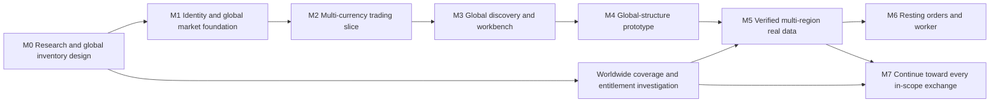

# Implementation roadmap

**Planning baseline, corrected 20 October 2026:** target **all stock exchanges globally**. The earlier US-first/India-later plan is superseded. Global identities, currencies/FX, venue calendars, discovery and a coverage register are foundation requirements. The near-free budget applies to the prototype; worldwide real-data cost/entitlements need a separate verified plan. Estimates are focused contributor-days, not deadlines.

GitHub entry points: [research PR #1](https://github.com/DuhItzAniket/TradeCrafters/pull/1) and [roadmap tracker #2](https://github.com/DuhItzAniket/TradeCrafters/issues/2).

**Worldwide inventory progress — 24 October 2026:** a [first dated evidence batch](implementation/inventory-review.md) assesses fifteen MIC records across six regions, retains all 2,889 rows in a reproducible CSV, and tracks Bhutan/Ethiopia identity gaps separately. Eleven records have cash-equity presence evidence, two are other facilities and two remain deliberately unknown. The worldwide denominator, actual prior effective baseline and real capabilities remain open.

**M5 started — 24 October 2026:** [private Twelve Data/EODHD history adapters](implementation/provider-history.md) now have strict mapping/access gates and repeatable local HTTP contract checks. The [private research coordinator](implementation/provider-coordination.md) adds shared MySQL account/feed quotas, fenced leases and a bounded opt-in cache, verified with actual SQL/HTTP failure tests. No current provider account is available; real responses, account rights, hosted research capacity, market-rule review and worldwide coverage remain unaccepted. M3 student feedback is being collected separately. This first slice does not enable real data in the hosted app.

**M4 accepted — 22 October 2026 (21 October UTC):** the [personal synthetic demo](implementation/m4-acceptance.md) is deployed on Vercel Hobby/Mumbai and Aiven Free/Bangalore. Required CI passes **164 checks** plus build/audit/recovery/container gates. Hosted identity/trading/FX, lost-response recovery, audited controls, exact TLS/grants/caps, capacity/overload, encrypted isolated restore, independent custody, lifecycle/audit protection, CSP, smoke and compatible rollback/promotion are verified with explicit limits. M3 student walkthroughs remain deferred; M5 real-data capabilities and the complete worldwide inventory remain open.

**Execution update — 20 October 2026:** M1/#3 and M2/#4 are complete. [M1 acceptance](implementation/m1-acceptance.md) and [M2 acceptance](implementation/m2-acceptance.md) retain their 80/108-check baselines. The [M3 workbench implementation](implementation/workbench.md) adds integrated discovery/chart/ticket and account interactions, with 116 automated checks. **M3/#5 remains open for real student feedback**, deferred by the owner; [the protocol](design/student-walkthrough.md) has no observed results yet. Public HTTPS deployment remains M4, evidence-backed real-data enablement M5, and the complete reviewed worldwide universe #9/M7. The original exit criteria below remain the baseline.

| Implementation issue                                         | Work                                                                |
| ------------------------------------------------------------ | ------------------------------------------------------------------- |
| [#3](https://github.com/DuhItzAniket/TradeCrafters/issues/3) | M1 foundation and verified identity                                 |
| [#4](https://github.com/DuhItzAniket/TradeCrafters/issues/4) | M2 trading integrity and accounting                                 |
| [#5](https://github.com/DuhItzAniket/TradeCrafters/issues/5) | M3 responsive workbench and order experience                        |
| [#6](https://github.com/DuhItzAniket/TradeCrafters/issues/6) | M4 deployment and hardening                                         |
| [#7](https://github.com/DuhItzAniket/TradeCrafters/issues/7) | M5 broad-provider evaluation and multi-region real-data integration |
| [#8](https://github.com/DuhItzAniket/TradeCrafters/issues/8) | Later worker and resting orders                                     |
| [#9](https://github.com/DuhItzAniket/TradeCrafters/issues/9) | Global venue inventory, capability register and coverage expansion  |

## Milestones and dependencies

**M4 is a prototype milestone, not completion of the global real-market objective.** Global identity, wallets, exchange policies and discovery are already required by then. Real-data investigation proceeds alongside implementation. M5 enables verified capabilities across regions; M7 closes the remaining worldwide coverage gaps. No default country order is imposed: batch readiness depends on rights, data quality, local rule support and cost.

| Milestone                                             | Indicative effort                                            | Deliverable                                                                                                       | Exit criteria                                                                                                                                                                                                |
| ----------------------------------------------------- | ------------------------------------------------------------ | ----------------------------------------------------------------------------------------------------------------- | ------------------------------------------------------------------------------------------------------------------------------------------------------------------------------------------------------------ |
| **M0 — Research and worldwide inventory design**      | Research package prepared; inventory population remains work | Audit, sources, global architecture, coverage schema, design brief, GitHub plan                                   | Record decisions and inventory provenance; account for unknown/missing markets. Documentation fixes no code vulnerabilities.                                                                                 |
| **M1 — Reproducible global foundation and identity**  | 6–10 days                                                    | Additive app/migrations, MySQL/auth/CI; venues, securities/listings, native wallets, policy/coverage contracts    | Fresh clone and verified auth work; same-symbol cross-venue identities stay distinct; no US/USD schema restriction; no ignored source or imported secrets.                                                   |
| **M2 — Multi-currency trading vertical slice**        | 7–12 days                                                    | Synthetic quote → native-wallet fill/journal → portfolio/receipt; explicit virtual FX                             | Exact arithmetic, idempotency and SQL isolation; multiple currency exponents/quote units; per-currency reconciliation; native funds, lots/ticks and local sessions enforced.                                 |
| **M3 — Global discovery and designed workbench**      | 6–10 days                                                    | Search/filter by exchange/region/currency, native ticket, reporting FX, holdings/activity and honest capabilities | Mobile/keyboard/receipt recovery and student walkthroughs; missing coverage visible; native funds distinct from converted totals; no unsupported trading controls.                                           |
| **M4 — Deploy and harden the public synthetic demo**  | 3–5 days                                                     | Vercel + managed MySQL deployment and runbook                                                                     | Isolated preview/CI data; TLS/least privilege; persistent abuse controls; sanitized logs; clean secret/dependency review; backup restore drill; measured load/connection budget; readme and creator credits. |
| **M5 — Entitled multi-region real-data capabilities** | Re-estimate after venue/plan evidence and a provider spike   | Broad-provider adapter(s), regional gap strategy, coverage register and verified multi-region pilot               | Written use/retention scope per capability; quota/quality tests; native-currency/session/FX behavior; no assumed global live coverage; corporate actions or explicit session-only restriction.               |
| **M6 — Durable orders/learning extensions**           | 5–10+ days, scoped separately                                | Worker and DAY limits, reservations, recovery; journal when useful                                                | No offline-order promise without evaluator; cancel/fill race tests, duplicate/gap handling, restarts, costs, and reconciliation pass.                                                                        |
| **M7 — Worldwide coverage completion**                | Ongoing batches; estimate per verified venue gap             | Work toward every in-scope stock exchange, including smaller/frontier venues                                      | Dated inventory denominator; no silently omitted markets; per-venue listings/data/rules/rights evidence; gaps remain open until resolved. Directory presence is not a completed trading integration.         |

M1–M4 total roughly **22–37 focused days**, with substantial uncertainty. This is a global-structure prototype estimate, not a delivery estimate for every real exchange. Full worldwide coverage needs inventory/contract evidence before a defensible schedule or data budget can be set. Do not compress correctness/security gates to hit a visual-demo date.

## Implementation work items

### M1: foundation

- Rotate/revoke the historical configuration credentials identified by TC-19; review provider/database activity privately. A current-tree deletion alone is not remediation. The owner confirmed rotation/revocation on 20 October; no independent issuer activity audit is claimed. See [credential disposition](implementation/m1-acceptance.md#credential-disposition).
- Create `apps/web` and shared packages without deleting the legacy source. Pin compatible supported framework/runtime versions.
- Resolve schema/query/auth adapter compatibility using a real MySQL technical spike. Keep schema migration code in Git.
- Add operating/segment venue identity, securities versus listings, effective-dated provider mappings, currencies/quote-unit multipliers, native wallets, local session/lot/tick policies and the capability register from the first schema.
- Implement verified identity, account ownership, session revocation, stable error contracts, bounded inputs, and exact trusted origins.
- Start with supported social account creation; add email/password only after verification and recovery are operational. Bootstrap admin explicitly with MFA/reauthentication.
- Set up typecheck/lint/build checks and isolated MySQL integration jobs. Add dependency/secret review and lockfile reproducibility.

### M2: trading integrity

Implementation: [trading/accounting contract](implementation/trading-accounting.md) and [acceptance evidence](implementation/m2-acceptance.md). The first exercise uses fixed reference quotes and a frozen local clock; historical/chart data is not fabricated for this milestone.

- Implement synthetic instrument metadata, server-owned scenario clock, bounded chart/quote contracts, and no future-data access.
- Use multi-region scenarios to verify native wallets, explicit FX and reporting conversions; adding a wallet cannot mint another opening grant.
- Implement one account lock, exact prices/money, idempotency body hashing, fill model v1, cash journals, and cost-basis rules.
- Return persistent receipts and structured rejection codes. Implement safe reconciliation after an unknown HTTP outcome.
- Keep the legacy bug probes as evidence; write new regression checks against the new domain behavior rather than preserving buggy outputs.

### M3: interface

Software implementation and browser evidence: [workbench record](implementation/workbench.md). Remaining acceptance: [3–5 real student walkthroughs](design/student-walkthrough.md) and resulting material fixes. The owner deferred those sessions; engineering automation does not close that gate.

- Translate [the design brief](research/03-product-and-experience.md) and [design study](design/workbench.html) into components with an intentional visual system.
- Complete chart, order-review/submit/receipt, portfolio and activity flows. Query invalidation must keep cash and positions consistent.
- Add exchange/region/currency discovery, ambiguous-ticker disambiguation, native wallet funding and FX timestamp/completeness. The existing USD visual study is a listing-view example, not the complete global interaction design.
- Implement no-positions, loading, closed, stale, unavailable, submitting, rejected, and unknown-outcome states.
- Verify at 390px, 768px and desktop widths; keyboard navigation, labels/contrast, reduced motion, and chart alternatives.
- Run 3–5 observed student walkthroughs; record outcomes and make concrete changes.

### M4: deployment

**Accepted:** [M4 evidence](implementation/m4-acceptance.md) closes the personal synthetic-demo gates, with [setup](implementation/deployment-foundations.md), [lifecycle](implementation/data-lifecycle.md) and [release/incident operations](implementation/release-operations.md). The work items below remain the implementation baseline. M3 student feedback stays deferred and is not marked complete.

- Resolve hosting/DB region, free-tier limitations, TLS trust, actual connection budget and preview isolation before production setup.
- Document credentials by **name**, never value; use separate application/migration identities and environment scopes.
- Enable persistent rate limits, instrument/account quotas, an admin pause switch and sanitized logs.
- Rehearse migration, backup restore, rollback, provider-outage behavior and basic incident response.
- Replace aspirational feature claims with verified behavior, screenshots, limitations, creator attribution and demo instructions.

### M5 and later

- Record a private data-entitlement agreement/approval; publish only an appropriate non-sensitive summary.
- Evaluate Twelve Data/EODHD against the worldwide inventory; add adapters/gap vendors by verified capability, with per-provider/feed budgets, response validation, timeouts, local calendar/rule versions and isolated failure behavior.
- Restrict real accounts to resettable sessions until corporate actions and comparable historical valuation are correct.
- Add a transactional outbox/worker only when resting orders or another durable async need is accepted. Keep financial writes in the shared domain service.
- Populate and review the complete global venue inventory; create actionable gaps and release batches until every in-scope exchange is accounted for. Apply per-venue approval gates worldwide; Kite's restriction is one Indian-market example, not a geographic boundary.

## Required verification matrix

| Scenario                                                                                                      | Required result before M4                                                                            |
| ------------------------------------------------------------------------------------------------------------- | ---------------------------------------------------------------------------------------------------- |
| No session, forged username, or another user's account/order ID                                               | Denied server-side; zero account mutation                                                            |
| Unknown side, missing/extra fields, strings where integers are required, negative/fractional/oversized values | Deterministic validation failure; no writes or upstream work beyond the allowed request budget       |
| Concurrent buys exceeding available cash                                                                      | Only affordable order(s) fill; cash/inventory/journals reconcile                                     |
| Concurrent sells and first purchases of the same instrument                                                   | No oversell or duplicate position rows                                                               |
| Same idempotency key, concurrent duplicates                                                                   | One order/fill/journal and the same returned outcome                                                 |
| Same key with changed body                                                                                    | Conflict, no second trade                                                                            |
| Crash before commit, crash after commit before HTTP response                                                  | Rollback before commit; original result on retry after commit                                        |
| Decimal rounding, repeated buy/sell, partial liquidation                                                      | Exact minor-unit reconciliation and zero residual basis on final liquidation                         |
| Missing/stale/future quote, closed session, upstream 429/error JSON                                           | No execution; informative status and bounded requests                                                |
| SQL failure midway through posting                                                                            | No partial cash/position/fill state                                                                  |
| Reset concurrent with order                                                                                   | Serialized explicit outcome; old history preserved                                                   |
| Mobile/keyboard trade and unknown outcome                                                                     | Usable review/receipt flow; no double submit or inaccessible blocking UI                             |
| Same ticker on different exchanges, cross-listing and symbol rename                                           | Distinct listing identity and effective-dated mappings; no accidental position merging               |
| Different currency exponents, quote-unit multipliers and explicit FX                                          | Exact native-wallet reconciliation; no 100× quote-unit error or false cross-currency journal balance |
| Local breaks/holidays, independent DST changes and lot/tick policies                                          | Execution eligibility follows the specific venue/segment policy                                      |
| One venue/feed or FX mark unavailable                                                                         | Affected execution/reporting states are explicit; unrelated eligible venues continue                 |

M5 adds captured provider/venue contract fixtures, real calendar/halt/source/adjustment evidence and per-region quota/outage tests. M6 adds reservations, cancel/fill races, expiry, event duplication, restarts and gap recovery. M7 requires coverage accounting against the reviewed worldwide denominator, including unsupported venues.

## GitHub as the project record

- Use the roadmap tracking issue as the entry point, with milestone-sized implementation issues linked to this document.
- Each issue states user behavior, relevant audit IDs/ADR, scope, dependencies, acceptance evidence and estimated size. Assign people only after they agree; do not infer Annapurna's ongoing involvement from historical authorship.
- Work in focused branches and pull requests linked with `Refs #...` or `Closes #...` where appropriate. Keep `main` runnable; use feature flags for incomplete surfaces.
- PRs explain the change and how it was verified. Financial-rule changes include invariant evidence; UI changes include screenshots and state/mobile checks.
- Protect `main` with required checks/review once CI exists, subject to repository plan support. Set up a Project board with Backlog → Ready → In progress → Review → Done if useful; no board is assumed to have been created by this documentation.
- Update ADRs when a decision changes; attach revised costs/permissions before enabling new data modes. A feature is Done only when deployed behavior and its limitations match the documentation.

Use the repository's issue and PR templates. Research evidence is a dated baseline; future security issues should use private reporting where possible instead of publishing credentials or exploit details in public tickets.
