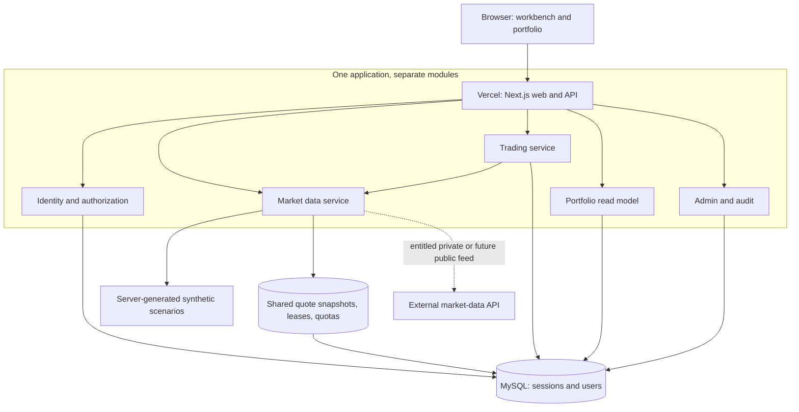

# Proposed architecture

**Status:** proposed, 20 October 2026. Designed for one or two contributors and a near-free personal demo. This is a deployable design, not a claim that infrastructure or the new application already exists.

## Alternatives considered

| Option | Strength | Cost/complexity | Decision |
| --- | --- | --- | --- |
| Repair CRA + Express + MySQL in place | Smallest conceptual change; reuses component code | Must still replace authentication, transaction logic, schema, contracts, and build tooling; two deployable apps | Keep as a reference and possible short-term repair path; limited reuse of unsafe flows |
| **Next.js + TypeScript + MySQL modular monolith** | One origin, shared contracts, relational integrity, straightforward Vercel deployment, portable Node runtime | Requires learning framework boundaries and managing database connection limits | **Recommended** for the redesign |
| React/Vite + Express or Fastify + MySQL | Familiar split frontend/backend; good container portability | Two app deployments, cookie/origin/proxy configuration, duplicated contracts unless shared | Strong alternative if preserving Express is a priority |
| Next.js + PostgreSQL/Neon | Attractive serverless ecosystem, branching and pooled access | Adds a database migration and dialect change without solving a uniquely PostgreSQL problem | Optional alternative; not needed to modernize this MySQL project |
| Separate trading, auth, pricing, portfolio microservices | Independent scaling for large teams | Distributed consistency, queues, deployments, monitoring, and cost disproportionate to this project | Defer; extract only when a measured bottleneck requires it |

MySQL/InnoDB supports the transactions and locking this simulator needs. [MySQL guidance](https://dev.mysql.com/doc/refman/8.0/en/innodb-best-practices.html) recommends grouping related writes in transactions and using locking reads where appropriate. Framework changes do not substitute for domain correctness.

## Proposed stack

| Concern | Choice | Reason / boundary |
| --- | --- | --- |
| UI + HTTP API | Next.js App Router, React, TypeScript | Same-origin `/api/v1` endpoints and a good Vercel path; trading/chart surfaces are interactive client components |
| Runtime | Supported Node.js LTS, aligned in local dev/CI/hosting | Resolve exact supported versions at scaffold time; do not preserve the old README's Node 14 minimum |
| Domain rules | Framework-independent TypeScript modules | Execute the same accounting rules in HTTP handlers and a future worker |
| Persistence | MySQL/InnoDB, reviewed versioned migrations | Foreign keys, checked constraints, durable journals; SQL transaction adapter owns a single connection |
| Query/schema layer | Drizzle candidate plus explicit transaction/locking SQL | Typed schema with inspectable migrations; finalize adapter compatibility in the first technical spike |
| Authentication | Better Auth candidate with MySQL-backed sessions | Own the identity/session data; supported [MySQL adapter](https://better-auth.com/docs/adapters/mysql); use library flows rather than custom JWT/password infrastructure |
| Validation | Zod or equivalent runtime schemas | Validate every incoming body and upstream response; TypeScript alone does not validate JSON |
| Client data | TanStack Query candidate | Shared cache, mutation invalidation, retry control, and request cancellation |
| Charts | TradingView Lightweight Charts candidate | Focused financial chart rendering; data remains our responsibility; retain its [license/NOTICE attribution](https://github.com/tradingview/lightweight-charts/blob/master/NOTICE) |
| Styling | CSS variables and purposeful components; accessible headless primitives where needed | Build the product's own hierarchy and interactions instead of applying an unrelated dashboard template |
| Verification | Unit/property checks for domain math, MySQL integration checks, browser flows | Verify invariants and complete user actions, not implementation-shaped snapshots |

These are researched recommendations, not installed packages. Pin a compatible stable set and evaluate known advisories before implementation. For auth, validate email verification/recovery, trusted origins, session revocation, admin MFA, and database rate-limit storage. If operational ownership is undesirable, evaluate hosted Clerk as an alternative with its current free-plan conditions; do not integrate both.

## Initial deployment topology



There is no required always-on worker, Redis server, message broker, Kubernetes cluster, or paid observability subscription in the first release. The synthetic market advances from a server-controlled scenario clock when requested; it does not require a timer to keep a process alive. Account state is durable in MySQL.

Real-data refresh is request-driven and globally coalesced. Quiet periods need no background ingestion. This first version does **not** promise execution of resting orders while nobody is connected. Any feature that needs that guarantee belongs in the worker milestone.

## Module boundaries

| Module | Owns | Must not do |
| --- | --- | --- |
| Identity | User mapping, sessions, role checks, account access | Trust a username/role/account owner from the browser |
| Market data | Instruments, provider normalization, snapshots, freshness, trading calendar | Change balances or silently alter an account's feed |
| Trading | Orders, idempotency, fill policy, account locks, fills, ledger writes | Accept a client execution price or make network requests while holding a financial lock |
| Portfolio | Positions, marks, cash/equity/P&L reads and reconciliation | Infer cash from formatted description text or value missing marks at zero |
| Admin | Suspension, pause switch, instrument allowlist, audited resets | Rewrite fills, grant roles via profile edits, or expose provider secrets |
| Learning | Journals, fill explanations, later scenario objectives | Promise investment returns or conflate model performance with real execution |

Suggested additive layout, to be created during implementation:

```text
apps/web/                 Next.js UI, API handlers, server composition
packages/domain/          Orders, ledger rules, P&L, fill model; no Next imports
packages/contracts/       Validated request/response and error contracts
packages/database/        MySQL schema, migrations, transactions, repositories
packages/market-data/     Synthetic and real adapters; calendar and quality rules
docs/                     Research, architecture, decisions, roadmap, design
```

Use npm workspaces initially. A monorepo build orchestrator is optional and should earn its complexity. The old `client/`, `server/`, and SQL files remain readable until a release tag and migration plan explicitly retire them.

## Trade request sequence

```mermaid
sequenceDiagram
  participant U as Browser
  participant A as API
  participant S as Session/ownership
  participant Q as Market data
  participant D as MySQL
  U->>A: POST order + Idempotency-Key
  A->>S: Verify identity, origin, permission, rate limit
  A->>D: Read existing idempotent result
  alt Prior result exists
    D-->>A: Same payload hash + stored result
    A-->>U: Original order outcome
  else New request
    A->>Q: Obtain eligible snapshot outside transaction
    Q-->>A: Snapshot + provenance + quality
    A->>D: Begin on one connection; lock account
    A->>D: Recheck idempotency, limits, freshness and funds
    A->>D: Persist order + fill + cash journal + position + result
    A->>D: Commit
    A-->>U: Durable fill receipt + account version
  end
```

Read the [domain design](trading-and-data-model.md) for precise atomicity, rounding, and idempotency semantics. If the response is lost after commit, replaying the same request returns the stored outcome even if market data is now unavailable.

## Later realtime topology

An optional ingest/evaluation worker can run on AWS ECS/Fargate while the frontend remains on Vercel. It consumes entitled prices, acquires a renewable feed-leader lease, evaluates eligible resting orders, and uses the same trading service and SQL transactions. Use a transactional outbox before publishing durable order events; consumers deduplicate by event ID. Queue delivery is at least once, not exactly once.

Vercel currently documents [WebSockets in beta](https://vercel.com/docs/functions/websockets). Connections are bounded by function duration and reconnects can land on another instance. That makes sockets an option for later UI updates, not an excuse to put a durable order book or a globally unique feed connection in function memory. Polling is sufficient for the budget MVP.

See [operations](deployment-and-operations.md) for Vercel-only, hybrid, and AWS-only deployment paths, including private-database access and costs.
