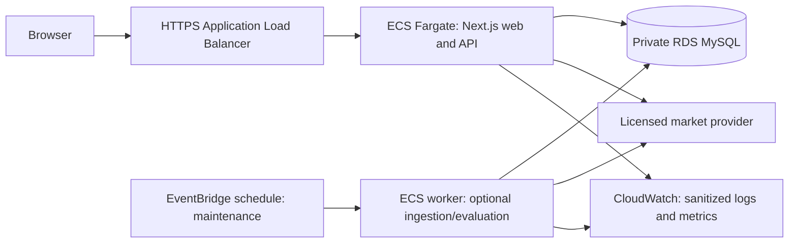

# Deployment, security, and operations

**Proposed, 20 October 2026.** No deployment was performed. Recheck plans, regions, networking, runtime versions, and entitlements before provisioning.

The market scope is **all stock exchanges globally**. Global identity, currencies, calendars and capability controls are initial application requirements; enabling real data is governed by the [global coverage plan](global-markets.md). The prototype budget below does not price universal worldwide real-time data.

## Path A: near-free Vercel demo (recommended first)

Run the Next.js app and API on Vercel; use external managed MySQL with TLS and server-generated synthetic data. Relative `/api/v1` URLs remove the legacy localhost coupling. All private account endpoints use `private, no-store`; only genuinely public, non-personal data can be CDN-cached.

[Vercel Hobby](https://vercel.com/docs/plans/hobby) is for personal/non-commercial projects and is usage-limited. The owner can collaborate on GitHub while one account owns the demo deployment; do not assume free paid-team features or an SLA. Frequent background refresh cannot rely on Hobby cron: its documented minimum is [once per day with coarse scheduling precision](https://vercel.com/docs/cron-jobs/usage-and-pricing). Request-driven data removes that requirement for the MVP.

[Aiven free MySQL](https://aiven.io/docs/products/mysql/concepts/mysql-free-tier) currently documents 1 CPU, 1GB RAM/storage, backups, 76 maximum connections, one free MySQL service per organization, no VPC, and no SLA/support. Inactive services can be powered off, and the provider may change region/configuration. Do not promise a selected region, high availability, or unlimited production usage.

Plan connection capacity before launch: a pool maximum of 2 per function instance is a **per-instance** limit, not a global cap. Keep functions near the actual database region where possible, bound connection/queue acquisition time, release connections in `finally`, and use short transactions. Test a burst of cold instances; reserve connections for auth and administration. If the plan cannot enforce an aggregate connection budget, reduce exposure/concurrency or move the API to a bounded container/pool proxy. Do not solve exhaustion by increasing unbounded connections.

Free-tier public database endpoints require authenticated encrypted access with verified CA/hostname, separate restricted application and migration users, and narrow network rules where the plan permits. Vercel egress addresses may not be static. Confirm the actual available network controls; broad network reachability is a conscious demo limitation, never permission to use weak credentials or disable TLS validation. A private database requires the AWS/API path below rather than assuming Vercel can reach its private address.

## Budget envelope

| Item | Near-free target | Qualification |
| --- | ---: | --- |
| Vercel personal demo | $0/month | Within Hobby eligibility and quotas; exceeding limits can pause service |
| MySQL | $0/month | Free tier subject to published limitations and availability |
| Optional MySQL developer upgrade | $5/month | Current [Aiven price](https://aiven.io/pricing/mysql); developer tier still has restrictions |
| Synthetic data | $0 provider cost | Generated by the project; ordinary hosting usage still applies |
| Authentication | No hosted-auth subscription in proposal | Better Auth runs in the app; launch social sign-in to avoid requiring transactional email initially; provider registration and setup are still needed |
| Real market data | Excluded until permission/quote is confirmed | Private basic access or an educational grant may be free; public distribution cannot be assumed free |
| Domain, email, monitoring add-ons | Optional, separately budgeted | Start with the platform subdomain, built-in logs, and minimal metrics |

**Target: $0–5/month for a small synthetic personal demo, not a guarantee at arbitrary traffic.** [Vercel Pro currently starts at $20/month](https://vercel.com/pricing) with usage/seat conditions. A public real-data product can cost much more than its hosting. Do not provision paid resources just to satisfy an architecture diagram.

For global data, estimate cost by provider + venue/segment + capability + permitted audience + active subscription/retention volume. A directory entry, global EOD plan, or permission for one exchange is not permission for all venues live. Show the unresolved cost/coverage gaps explicitly rather than reducing scope to the US. The near-free synthetic prototype does not complete the real-exchange rollout.

Worldwide exchanges have different local sessions, so data workers/schedulers use venue calendars and provider/feed partitions. One provider/venue outage disables affected paths rather than all markets. Keep the ledger on one authoritative database initially; add read caching/replicas only when measured latency/load justify them. Global market scope does not require active-active multi-region writes.

## Path B: Vercel frontend + AWS API/worker

Use when a persistent ingest/evaluation worker or private RDS is justified. Keep the frontend on Vercel; forward same-origin `/api` requests through a documented AWS HTTPS front door. Run the API and optional worker in ECS/Fargate, with MySQL in private RDS subnets. The browser never connects directly to the database. Account for proxy timeout/headers, auth callback URL, cookie domain, origin checks, and duplicate proxy retries; test the complete flow.

The worker holds an outbound provider stream and a database leader lease; it is not a listener tied to a browser session. It shares domain logic with the API. Keep SQS/outbox optional until asynchronous events have a concrete consumer.

## Path C: AWS-only container deployment

Build a non-root Node container with the framework's supported standalone output, health checks, bounded resources, graceful shutdown, and a pinned lockfile. Push to ECR. Deploy behind an ALB with HTTPS; use Secrets Manager and task IAM roles, not credentials baked into images. RDS accepts traffic only from authorized application security groups. [AWS ECS documentation](https://docs.aws.amazon.com/AmazonECS/latest/developerguide/service-load-balancing.html) describes Fargate/ALB support. This design is an application-specific adaptation, not a claim that AWS's reference stack exactly matches it.

AWS costs include API and worker compute, load balancer, RDS/storage/backups, public IPv4, logs, egress, and potentially NAT/VPC endpoints. Persistent worker compute and network infrastructure make this a later paid path. Use a saved AWS Calculator estimate for the chosen region, operating hours, HA configuration, and traffic before deployment; no universal monthly AWS total is asserted. [Fargate pricing](https://aws.amazon.com/fargate/pricing/) is resource/time based.

Prefer ECS for new AWS container work here. [AWS's App Runner availability notice](https://docs.aws.amazon.com/apprunner/latest/dg/apprunner-availability-change.html) directs new designs toward ECS alternatives; verify account availability instead of assuming an old tutorial's deployment target remains open.

## Environment and release contract

| Scope | Configuration categories | Rules |
| --- | --- | --- |
| Public browser | App URL, non-sensitive presentation flags | Never provider keys, SQL credentials, auth secrets, admin grants, or trusted model seeds |
| App server | Database connection/CA, auth secret and OAuth callbacks, allowed origins, data mode, provider keys if enabled, model version, rate/budget caps | Validate required names at startup; private secret store; separate Preview/Production |
| Database migration job | Migration identity and schema target | Single serialized job; backed up and reviewed; never automatically triggered by every cold start |
| Worker (later) | Provider entitlement, stream/lease config, private database access, model version | Separate IAM/credential scope; same domain version as API |

Use a local MySQL container with named disposable development data and documented setup. CI gets an isolated MySQL service with synthetic fixtures. Previews receive isolated disposable data/credentials and synthetic mode only. Never point a pull-request preview at production accounts or send secrets to untrusted fork workflows. Aiven free's one-service/no-fork limit means unrestricted automatic preview databases cannot be promised; provision an appropriately isolated preview plan or skip DB-backed public previews until available.

Deployment sequence: checks pass → review additive migrations → backup → serialized migration → deploy compatible app → smoke test auth/trade/receipt/portfolio → confirm reconciliation/health → expose the release. Use expand/contract schema changes so code rollback remains possible; rolling back code does not undo a migration or a journal entry.

## Security requirements

- Auth library verifies session and revocation server-side on financial/admin requests. Use Secure, HttpOnly, appropriate SameSite cookies; exact trusted origins, CSRF protections and bounded request bodies. Avoid wildcard trust of all preview domains.
- Start with supported OAuth sign-up/sign-in. Add email/password only with verification and recovery actually delivered/tested; do not reuse unverified legacy sessions. Admin bootstrap is an explicit operator action, requires MFA/reauthentication, and cannot be claimed by the first registrant.
- Account and order ownership checks are required even for opaque IDs. Ordinary users cannot set roles, balances, feeds, model parameters, or execution prices.
- Persist rate-limit counters in the database initially; in-process counters alone are insufficient across functions. Apply per-account and per-IP controls to auth, order, reset and proxy endpoints. Add a provider-wide quota independent of user limits.
- Use parameterized SQL, least-privilege users, reviewed CSP/security headers, dependency/secret scanning, encrypted backups, and sanitized structured logs. Keep errors actionable without SQL diagnostics.
- Maintain an emergency trading-pause switch that the API and worker both enforce. If authorization, ledger reconciliation, or eligible market data fails, reject new execution while preserving read access where safe.

These controls respond to observed code paths and the [OWASP API risk model](https://devguide.owasp.org/en/07-training-education/07-api-top-ten/); they do not constitute a completed compliance certification.

## Observability, recovery, and data retention

Log correlation ID, route, outcome code, duration, account pseudonymous ID, model version and order ID. Never log passwords, session cookies, authorization headers, provider keys, email addresses, or raw personal notes. Retain operational logs briefly, with explicit deletion and access rules.

Measure auth errors, order rejection reasons, unknown-outcome reconciliation, quote age, provider quota headroom, SQL connections/lock waits/deadlocks, journal mismatch, and worker lag later. Initial proposed alert conditions: any reconciliation mismatch; repeated stale-source failures during an active session; database capacity approaching its tested safe ceiling. Thresholds are tuning proposals, not measured baselines.

Run reconciliation after every integration-test scenario and on operator-triggered/bounded daily checks in the demo. Backups must be **restored** in a rehearsal. For the small demo, propose RPO ≤24h and RTO ≤4h only after a restore drill proves the selected plan can meet them; otherwise state the measured limits. For an AWS upgrade, [RDS automated backups](https://docs.aws.amazon.com/AmazonRDS/latest/UserGuide/USER_WorkingWithAutomatedBackups.Enabling.html) and PITR can support stricter objectives with the appropriate configuration.

Cache only what the data entitlement allows. Keep fill evidence as required/permitted, purge unreferenced snapshots and expired rate-limit rows in bounded batches, and cap chart ranges. Archive/reset accounts without editing historical outcomes. Adopt a user-facing retention/deletion policy before public registration.

## Migration from coursework

1. Tag the legacy baseline; keep its source and creator attribution.
2. Inventory any real deployment and data privately; do not execute destructive legacy SQL against it.
3. Create a clean new schema with repeatable forward migrations. Start new virtual balances rather than treating old balances as trustworthy financial history.
4. Offer an optional read-only legacy import after schema mapping/reconciliation; mark imported history and its provenance. Require new auth enrollment where password/session compatibility is unproven.
5. Cut over only after release gates pass; preserve a tested rollback path and make legacy mutations unavailable.
