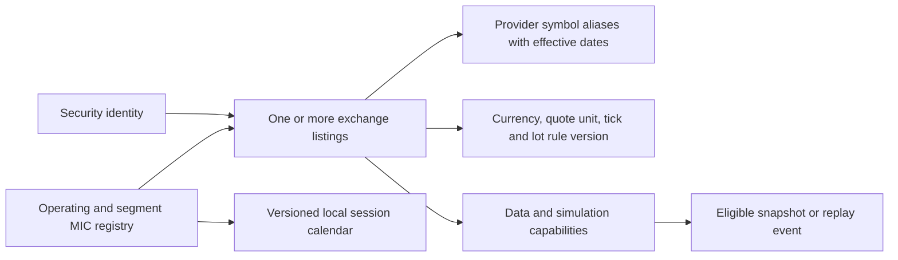

# Global exchange architecture and coverage plan

**Scope correction, 20 October 2026:** the product goal is **all stock exchanges globally**. The previous US-first/India-later plan is superseded. Global identity, currencies, calendars, discovery, and coverage management are foundation work. Enabling data in readiness-based batches does not change the worldwide scope or silently impose a US-first launch order.

## Define the universe and measure the gaps

Maintain a versioned inventory of active cash-equity exchanges and their equity segments worldwide, including smaller and frontier markets. Include the Americas, Europe, Asia, Oceania, Africa, and the Middle East. US, UK, India, Japan, Hong Kong, continental Europe, Canada, Australia and South Africa are examples for testing, not a complete target list.

Use the official [ISO 10383 MIC register](https://www.iso20022.org/market-identifier-codes) as an identity reference, with operating/segment relationships, status and effective dates. MICs also identify facilities that are not cash-equity exchanges; do not classify every MIC as a stock exchange. Supplement the inventory with exchange evidence and provider coverage. A newly published register change must not be applied before its effective date.

The inventory denominator is the dated, reviewed cash-equity universe, rather than a provider's marketing count. Every included venue gets a status, including unknown and missing coverage. Record new, renamed, merged and deactivated venues without losing historical identity. Define whether a coverage claim means exchange, segment, listing or instrument; count each consistently.

| Capability | Meaning; stored independently |
| --- | --- |
| Directory | Venue identity and classification are known |
| Listings | Valid listing directory and provider mappings exist |
| Historical | Specific intervals/history and adjustment policy are verified |
| EOD / delayed / live | Separate price entitlements and freshness, not interchangeable labels |
| Public display / retention / replay | Each allowed use is evidenced, including audience and expiry |
| Simulation eligible | Prices, quote units, calendar, lot/tick rules, corporate actions and permitted use pass the product gate |

A provider's exchange directory is not proof of price coverage: Twelve Data explicitly says its [directory includes venues it does not yet carry](https://twelvedata.com/news/july-2026-update). Its [EOD coverage note](https://support.twelvedata.com/en/articles/12682324-end-of-day-eod-pricing-market-data) also lists markets that need additional licensing or are unsupported. These distinctions must be visible in the product.

Proposed coverage record: `venueMic`, `segmentMic`, `assetClass`, `provider`, `providerVenueCode`, `listingScope`, `capability`, `feedType`, `expectedDelay`, `allowedAudience`, `displayAllowed`, `simulationAllowed`, `retentionPolicy`, `replayAllowed`, `evidenceRef`, `checkedAt`, `effectiveFrom`, `expiresAt`, `status`, and `blockingReason`. Default unknown rights to disabled. Keep contracts and credentials private; expose a sanitized capability summary.

## Security master: securities are different from listings

An internal listing ID, not a bare ticker, identifies the traded position. The same ticker can identify unrelated securities in different markets. One security may have multiple listings; a depositary receipt or different share class may be a separate security. Store ISIN/FIGI only where their use and mapping are available; do not depend on buying identifier licenses for the core internal ID.

Provider composite exchange codes require explicit mapping. EODHD's [exchange API](https://eodhd.com/financial-apis/exchanges-api-list-of-tickers-and-trading-hours) distinguishes its composite US universe from individual venues, and calendar endpoint codes need not match ticker-list codes. Never treat a provider suffix as a canonical MIC.

## Multi-currency accounts from the first schema

- A simulation account has a user-selected **reporting currency**, immutable data mode, and one wallet per supported settlement currency. Native wallet balances are the funds available for orders; a converted reporting total is not spendable cash in every currency.
- Store currency exponent and quote-unit multiplier separately. Do not assume two decimal places or interpret a quote in pence as pounds. The [LSE's trade display explanation](https://www.londonstockexchange.com/stock/SGBX/wisdomtree/company-page) distinguishes minor quote units such as GBX from the corresponding major currency.
- If quote and settlement currencies differ, require an explicit priced conversion policy and provenance, or leave execution disabled; a unit multiplier alone is not a currency conversion.
- Each cash journal balances **within each currency**. FX conversion posts a linked source-currency journal and target-currency journal against currency-specific clearing accounts, with an immutable rate snapshot, rounding and modeled fee. Never add different currencies and call the sum balanced.
- Changing display currency does not convert wallets or rewrite fills. For the initial implementation, fix account reporting currency and expose explicit virtual FX conversion; reject an order without enough native funds. No invisible auto-conversion.
- A versioned opening grant is allocated across wallets from one fixed virtual budget, with recorded seed conversion rates. Adding a currency wallet does not mint a fresh grant. Historical funding and FX cannot appear as investment gains.
- Consolidated equity records both the native equity vector and base-currency conversion timestamps. Separate asset P&L, FX contribution and fees. A missing FX mark makes the aggregate incomplete; it does not invalidate a funded native-currency order unless the order needs FX.

Keep all money/FX arithmetic exact. USD examples elsewhere are worked examples only; they do not constrain the supported markets or currencies.

## Local market behavior

Every listing references a versioned venue/segment trading policy: IANA timezone, trading date, session intervals, holidays, early closes, auctions, breaks, halt state, lot size, tick table, price bands and eligible order types. Quote freshness depends on feed mode and the local session, rather than one fixed US timetable.

For example, [JPX documents separate morning/afternoon sessions](https://www.jpx.co.jp/english/equities/trading/domestic/01.html), and [HKEX explains board-lot versus odd-lot markets](https://www.hkex.com.hk/Global/Exchange/FAQ/Securities-Market/Trading/Securities-Market-Operations?sc_lang=en). These require specific policy fixtures, not a weekday-only open/closed flag. Do not infer a Tokyo session from a provider page's generic US-market widget.

The first reference-price model may simulate continuous-session, cash-only market orders where appropriate. Where a venue's price limits, auction-only behavior or lot rules are not modeled, identify the unsupported behavior and keep the relevant execution path disabled. A listing may be browseable or replayable before it is eligible for current-price simulation.

## Data adapters and global ingestion

Research **Twelve Data and EODHD as broad-coverage candidates**, then fill verified venue gaps with compatible regional/direct-vendor agreements. Alpha Vantage remains an educational-grant candidate; Alpaca/Massive/Tiingo are possible regional components rather than the global backbone. No verified single provider in this research establishes every worldwide stock exchange with free live public-simulator rights.

Map capability by listing/venue/feed/use case. Batch reference-data discovery and bounded historical imports; refresh live prices only for watched/held/requested listings within provider quotas. Partition caches, leases and budgets by provider/feed/listing/mode, and calendars by venue/segment. Page the directory server-side; never subscribe every browser to every global stock.

If streaming becomes justified, run per-provider/feed leader leases and region-aware reconnect/gap handling. One Asian feed outage must not stop eligible European data or wipe a global portfolio. A global administrator pause remains available separately. Place the single authoritative ledger near its primary database initially; worldwide market scope does not require active-active multi-region financial writes.

## Delivery and budget

Global design is required in M1–M3: the first schema, contracts and UI must demonstrate multiple venues, currencies and timezones. The near-free public demo can use clearly labeled synthetic regional scenarios. That prototype demonstrates the platform; it does **not** fulfill the real-market coverage milestone.

M5 enables verified historical, delayed or live real-data capabilities across a **multi-region** pilot and records remaining gaps. Further batches work toward every venue in the inventory. Batch order follows permitted use, feed quality, calendar/rule readiness and actual operating cost; no country is silently the product boundary. Directory presence alone never counts as a completed trading integration.

The $0–5/month estimate applies to small synthetic hosting, not universal global data. Broader real-market coverage requires a separately verified entitlement/cost plan. Delayed data and historical replay are product modes, not automatic substitutes for a requirement for live prices. The owner must be shown the verified cost/coverage tradeoff before paid provisioning or a change in fidelity.

## Acceptance evidence

1. Every in-scope venue is accounted for in a dated coverage inventory, including missing/unknown entries and a gap issue; coverage reporting cannot silently omit unsupported exchanges.
2. Same-symbol/different-venue listings never collide. Symbol changes, operating/segment relationships and multiple listings preserve identity.
3. Native currencies with different exponents and minor quote units, explicit FX, fees and rounding reconcile per currency and at reporting time.
4. Independent timezone/DST transitions, lunch breaks, early closes, local trading dates and non-Monday-to-Friday calendars behave correctly.
5. Board lots, tick ladders, price bands and eligible session types are enforced by versioned policy; unmodeled behavior has an explicit unsupported state.
6. Stale or unauthorized data on one venue disables only affected paths; portfolio completeness and per-venue status remain honest.
7. Cross-market corporate actions, delistings, dividends and adjustment policies are tested before multi-day real-market simulation.
8. Search, watchlists, order tickets, receipts and holdings always identify venue, native currency and data mode. Global aggregate values expose FX source/time/completeness.
