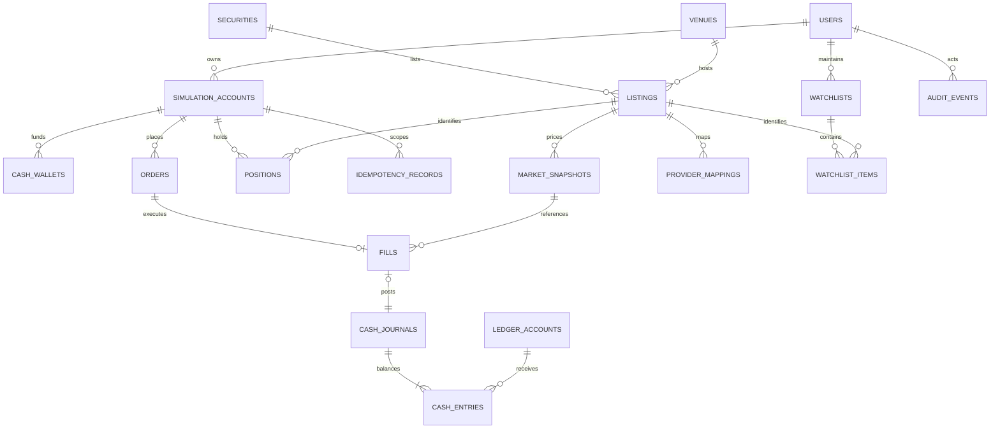

# Trading rules and data model

**Architecture baseline with an implemented M2 slice.** The [current execution contract](../implementation/trading-accounting.md) and [acceptance evidence](../implementation/m2-acceptance.md) take precedence where implementation choices differ: one active synthetic account per owner plus immutable archived history; a 100,000 virtual USD-equivalent opening grant; fixed venue-local exercise clock; exact `DECIMAL(30,0)` monetary columns and immutable JSON price/provenance; explicit server-issued quote IDs and `/api/trading` routes. Chart history, real data and resting orders remain later milestones. The broader model below retains the original design intent and worked examples.

## MVP scope

One multi-currency simulation account per data mode and user, with a chosen reporting currency and native-currency wallets. A versioned grant policy allocates one fixed virtual budget across wallets; `$10,000` is the USD worked example, not a new grant for every wallet. Global venues, listings, calendars and capabilities are part of the first schema. See [global market rules](global-markets.md).

Cash-only buy/sell market orders use permitted whole-share lot multiples and immediate fill/rejection in eligible continuous sessions. Synthetic scenarios declare their clock/policy. No real-money routing, external cash transfers, margin, shorting, options, fractional shares, resting orders or invisible auto-FX. Explicit virtual currency conversion is a separate reviewed operation.

Per-order quantity/notional caps, lot size and demo quotas use versioned listing/venue policy. A 1–1,000-share range is a sample scenario setting, not a universal rule for every exchange. Orders need enough native wallet cash or eligible inventory. Changing rules does not rewrite old fills.

## Monetary and inventory invariants

1. Every trading operation has an authenticated actor and an account they own. Admin operations use separate permissions and audit events.
2. Each native wallet and listing position stays nonnegative. Account operations serialize on the account row, including FX, resets and first purchases of a listing. A reporting-currency total cannot bypass insufficient native funds.
3. Each successful order has exactly one MVP fill. Each fill has one monetary journal. Journal entries sum to zero per currency.
4. Each wallet equals its opening journal plus its currency-specific deltas. Listing quantity and native cost basis reconcile to fills; FX conversion uses linked journals balancing independently per currency.
5. The same account/idempotency key/body hash always yields the same durable outcome. A key reused for a different body yields a conflict.
6. Every fill records a snapshot, source time, feed, market clock, model version, price, quantity, and fees.
7. No order uses a future quote, an ineligible stale snapshot, a daily close presented as live, or a client-selected fill price.
8. Account data mode, reporting currency, scenario identity and simulation-policy version stay fixed. Each listing's fill provenance identifies its approved venue/provider/feed; changing a feed requires a reviewed migration/comparability decision.

Use `DECIMAL(20,8)` for price/reference values, sufficiently precise validated decimal FX rates, and `BIGINT` native minor units for cash/notional/fees/basis. Serialize amounts as strings; never enable implicit DECIMAL-to-number conversion for financial math. Apply the listing's quote-unit multiplier before cash calculation; quantize prices to its versioned tick ladder and cash to the settlement currency's exponent using tested half-even rounding. Do not assume two decimal places. Quantities are bounded whole-share lot multiples. Avoid floating-point money and string concatenation.

## Fill policy v1

The first version is a **reference-price simulation**, not a representation of exchange execution, queue priority, or market depth. The UI says so in the receipt. Bid/ask-based execution is a future model with separate tests and feed entitlements.

- Obtain an eligible `last` reference from the listing's approved feed or synthetic source. Validate identity, quote units/currency, timestamps, local session, price bands and quote condition. Set freshness by feed/venue/mode; **10 seconds** is a proposed live-feed pilot default, not a global EOD/delayed-data rule. Reject implausible future times outside a documented clock-skew tolerance.
- Sample reference model: a **5-basis-point half-spread**, buying at `ceilToApplicableTick(last × 1.0005)` and selling at `floorToApplicableTick(last × 0.9995)`. Store the assumption/version and reference separately. Validate tick ladder, local price bands and quote-unit conversion; disable execution where a venue's rules are not represented. This model is not a claim of universal exchange execution fidelity.
- Commission is zero in v1 and explicitly shown as zero. These costs are simulation assumptions, not a broker or exchange fee schedule. Later fees require a new model version.
- Fetch/refresh the quote before acquiring the account lock. Recheck its eligibility inside the transaction; if it expired while waiting, abort safely. Never wait for a provider inside a financial transaction.
- Reject when closed, halted, stale, unavailable, unsupported, insufficiently funded, or lacking shares. No silent queue for the next open.
- Never use OHLC high/low to assert an executable price. Delayed accounts and historical replay need a separate simulation clock with no access to future bars.

USD worked example: a fictional listing has reference price `$100.00`, tick `$0.01`. Two shares buy at `$100.05`, cost `$200.10`, and reduce `$10,000.00` cash to `$9,799.90`. An immediate sale at the unchanged reference fills at `$99.95`, returning `$199.90` and realizing a `$0.20` modeled spread loss. Other currencies/quote units follow their own policy; this calculation is not a market-scope restriction.

Even professional paper systems document limits such as simplified top-of-book fills. [IBKR's explanation](https://www.interactivebrokers.com/campus/glossary-terms/paper-trading-account/) and [Alpaca's paper-trading limitations](https://docs.alpaca.markets/us/v1.4.2/docs/paper-trading) support describing model limits honestly; TradeCrafters is not reproducing either provider's execution model.

## Logical schema



Auth-library user/session/account/verification tables are generated by the chosen supported adapter and mapped to stable internal user IDs. Do not hand-design an incompatible auth schema from this conceptual diagram.

| Table                                               | Key fields and constraints                                                                                                                                                          |
| --------------------------------------------------- | ----------------------------------------------------------------------------------------------------------------------------------------------------------------------------------- |
| `simulation_accounts`                               | ID, owner FK, reporting currency, mode/scenario/policy, version, status; one active account per owner/mode identity; no single cross-currency cash field                            |
| `currencies`, `cash_wallets`                        | Currency exponent; unique account + native currency; nonnegative minor-unit balance and version                                                                                     |
| `venues`, `venue_policies`                          | Operating/segment MIC identity, effective dates/status, IANA zone, versioned calendar/session/tick/lot/price-band rules                                                             |
| `securities`, `listings`, `provider_mappings`       | Security ID, listing ID + venue/segment, effective-dated ticker aliases, quote/settlement currency and unit multiplier, provider codes; no global bare-symbol uniqueness assumption |
| `coverage_capabilities`                             | Venue/listing/provider/feed/use-case rights, history/freshness, evidence/review dates, blocking reason and enablement; unknown rights disabled                                      |
| `fx_snapshots`, `fx_conversions`                    | Currency pair, rate convention/source/time/mode, rounding/fee version, linked per-currency journal IDs, idempotent conversion request/outcome                                       |
| `orders`                                            | ID, account/listing/wallet FKs, side/type/status, quantity, request hash, rule/model versions, timestamps and rejection code; lot/notional validation                               |
| `fills`                                             | ID, order FK unique for MVP, snapshot FK, execution price, quantity, notional/fee minor units, model version/time; immutable                                                        |
| `positions`                                         | Unique account + listing, quantity, native total cost-basis minor units/currency, version; no negative quantity/basis; average cost derived                                         |
| `ledger_accounts`                                   | ID, owner simulation account when applicable, currency, purpose (trader cash, simulator clearing, funding, fees)                                                                    |
| `cash_journals`                                     | ID, kind, fill FK nullable/unique, funding/reset reference, time, currency; immutable after posting                                                                                 |
| `cash_entries`                                      | Journal FK, ledger-account FK, signed minor-unit delta; sum-to-zero validated by transactional posting and reconciliation                                                           |
| `idempotency_records`                               | Unique simulation account + key; normalized body hash, outcome/order ID, canonical response, created time; preserve for the account lifetime                                        |
| `market_snapshots`                                  | ID, listing/venue/quote units, provider/feed/mode, reference/bid/ask, source/receipt times, local session/date, quality/delay/policy; immutable fill evidence                       |
| `bars` (when licensed)                              | Listing, provider/feed, interval, exchange-local trading date and UTC timestamp, adjustment version, OHLCV; unique complete dimension key; licensed retention                       |
| `watchlists/items`                                  | Owner/list FK and unique list + listing; capped sizes; native venue/currency visible                                                                                                |
| `audit_events`                                      | Actor, action, target, reason, request correlation ID, time, sanitized metadata; admin changes append entries                                                                       |
| `refresh_leases`, `provider_budgets`, `rate_limits` | Shared atomic lease/counter state with expiry; cleanup bounded and separate from trade critical path                                                                                |
| `outbox` (later)                                    | Unique event ID, aggregate/version, payload, created/delivered times; transactional with writes                                                                                     |

Financial FKs use restrictive deletion. User deletion revokes sessions, removes journals/PII where policy permits, and closes/pseudonymizes the account through an explicit retention procedure; it does not casually cascade-delete accounting evidence. For this personal simulator, define a short, published retention policy before collecting public user data. Keep auth secrets, email addresses, and raw provider responses out of public telemetry.

The monetary journal is a **balanced virtual-cash journal**, not a complete brokerage general ledger. For an opening grant, debit trader cash and credit simulator funding by equal minor-unit amounts. A purchase transfers cash to simulator clearing; a sale transfers it back; fees post separately. Inventory/cost basis is reconciled through positions and fills. The sum of cash entries must be checked at posting time, because a row-level SQL CHECK cannot validate a cross-row sum.

## Transaction algorithm

1. Verify session, ownership, origin/CSRF protection, request limits, and runtime request schema. Unknown fields such as `username`, `executionPrice`, or a role are rejected.
2. Normalize the body for hashing (stable field order/casing and validated values). Look up an existing idempotency record before depending on market availability. Return its stored result or a body-hash conflict.
3. Obtain an eligible immutable market snapshot through the server's adapter. Enforce upstream budgets and short timeouts.
4. Acquire **one** connection; begin a transaction; `SELECT ... FOR UPDATE` the account row. Lock in a consistent order everywhere. Recheck account status and idempotency after acquiring the lock.
5. Insert the unique idempotency record; verify native wallet funds/inventory, quote/FX eligibility where needed, venue capability, lot/tick/session policy and account/model constraints. The account lock serializes first-listing positions and same-account FX. Explicit conversion has its own idempotent operation; order submission never silently converts.
6. Insert order/fill/native-currency journal/entries, update the native wallet and listing basis, increment account version, and store the canonical outcome. Domain rejections can persist an order/result without monetary changes. Authentication/shape failures need not create orders.
7. Commit; always rollback on failure and release the connection in `finally`. Retry deadlocks only a bounded number of times with the same key; never retry a trade as an unrelated new order.
8. Return a receipt; invalidate cash, positions, activity, and performance client queries. UI success requires a durable receipt. A transport timeout means outcome unknown until reconciled.

Use SQL constraints in addition to application checks. Atomic conditional updates and lock ordering must be integration-tested with real MySQL; an in-memory test does not establish isolation correctness. Do not use `pool.query('START TRANSACTION')` as a replacement for a checked-out connection.

## Valuation and cost basis

```text
native_position_value = roundToCurrency(quantity × quote_price × quote_unit_multiplier)
native_equity[currency] = wallet[currency] + sum(native_position_values[currency])
native_unrealized_pnl = native_position_value - native_remaining_cost_basis
reporting_equity = sum(native_equity[currency] × eligible_reporting_fx[currency])
reporting_net_pnl = reporting_equity - reporting_net_virtual_funding
```

Use total native cost basis, not a rounded average or today's converted base value, as stored accounting value. Buys add native notional/fees. A partial sale allocates proportional native basis by the rounding policy; the final sale consumes its residual. Native realized P&L is proceeds minus fees/basis. Preserve acquisition/disposal FX evidence for reporting attribution; identify asset and FX effects separately.

Unknown/stale marks propagate an incomplete/stale valuation status. Keep the cash number available but avoid displaying an apparently precise complete equity total. Performance series must use comparable timestamps and the same mode; deposits/resets and corporate actions cannot appear as investment gains. Initially chart the current session and documented snapshots; do not invent a historic equity curve.

Splits/dividends and ticker changes are prerequisites for multi-day **real-equity** portfolios. If they are not implemented, restrict real-data experiments to resettable sessions and label the limitation. Later corporate-action handlers must be idempotent and reconcile quantity/basis without double adjustment; never fill against adjusted historical prices while marking positions with raw prices.

## API outline

| Endpoint                                   | Responsibility                                                                              |
| ------------------------------------------ | ------------------------------------------------------------------------------------------- |
| `GET /api/v1/me`                           | Verified profile and owned simulation-account IDs                                           |
| `GET /api/v1/exchanges?...`                | Paginated global directory with per-capability coverage and missing/unsupported status      |
| `GET /api/v1/listings?query=...&mic=...`   | Capped venue-aware search; no US-only or bare-symbol assumption                             |
| `GET /api/v1/market/quotes?ids=...`        | Capped batch of normalized snapshots, freshness and mode metadata                           |
| `GET /api/v1/market/bars?...`              | Validated interval/range, adjustment/feed metadata, capped points                           |
| `GET /api/v1/accounts/:id/portfolio`       | Native wallets/positions/P&L plus timestamped reporting-currency valuation and completeness |
| `POST /api/v1/accounts/:id/fx-conversions` | Explicit idempotent virtual FX intent; server rate and paired balanced journals             |
| `POST /api/v1/accounts/:id/orders`         | Authenticated order intent + `Idempotency-Key`; no fill price                               |
| `GET /api/v1/accounts/:id/orders?...`      | Cursor-paginated orders/receipts; reconciliation lookup by key                              |
| `POST /api/v1/accounts/:id/reset`          | Confirmed close/archive + new account with a new opening grant; rate limited                |
| `POST /api/v1/admin/trading-pause`         | MFA/reauthenticated admin, reason, persistent audit event                                   |

Auth-library endpoints are mounted separately under its documented auth prefix. Use one contract for the page and API; do not carry forward legacy username-based resource authorization.

```json
{
  "listingId": "fictional-apex-usd-venue-1",
  "side": "BUY",
  "orderType": "MARKET",
  "quantity": 2
}
```

Amounts in responses are strings. Every error uses `{ "error": { "code": "QUOTE_STALE", "message": "Prices are out of date. Refresh before trading.", "requestId": "..." } }`. Use 401 for no session, 403/404 for inaccessible objects according to a consistent disclosure policy, 409 for conflicting idempotency/account state, 422 for invalid order rules, 429 for rate limits with retry guidance, and 503 for unavailable market data. No SQL messages reach clients.

## Later resting-order model

Only after a reliable evaluator exists: add `ACCEPTED -> OPEN -> PARTIALLY_FILLED -> FILLED`, plus `CANCELLED`, `EXPIRED`, and `REJECTED`; DAY before GTC. Reserve buying power/inventory while open; serialize cancel/fill races on account/order locks. Persist event sequencing, expiration calendars, gaps, and worker restart recovery. Limit-crossing based on bars alone cannot guarantee executable fills. Do not promise stops, partials, or GTC in the budget MVP.
