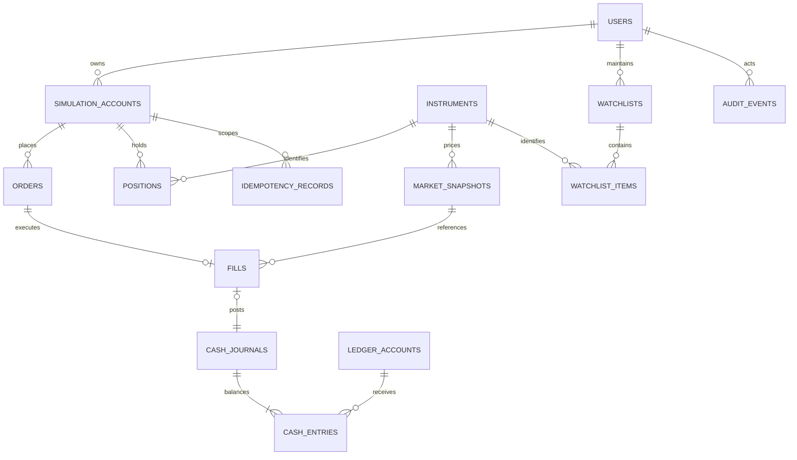

# Trading rules and data model

**Proposed contract, not implemented.** These rules define the first vertical slice and the tests that should establish it.

## MVP scope

One USD cash account per data mode and user; $10,000 initial virtual cash; whole shares; buy/sell market orders; immediate full fill or rejection; regular session only for real equities. Synthetic scenarios declare their own session and clock. No real-money brokerage connection, deposits, withdrawals, margin, shorting, options, fractional shares, or resting orders.

The per-order share/notional caps and per-account demo quotas are configuration with versioned defaults. Start at 1–1,000 shares and no more than the account's available cash/inventory. The product must explain the limits. Changing model parameters does not rewrite old fills.

## Monetary and inventory invariants

1. Every trading operation has an authenticated actor and an account they own. Admin operations use separate permissions and audit events.
2. Cash and available shares cannot go negative. Account operations serialize on the account row, including resets and first purchases of a symbol.
3. Each successful order has exactly one MVP fill. Each fill has one monetary journal. Journal entries sum to zero per currency.
4. Account cash equals its opening journal plus all cash deltas. Position quantity and cost basis reconcile to its fills.
5. The same account/idempotency key/body hash always yields the same durable outcome. A key reused for a different body yields a conflict.
6. Every fill records a snapshot, source time, feed, market clock, model version, price, quantity, and fees.
7. No order uses a future quote, an ineligible stale snapshot, a daily close presented as live, or a client-selected fill price.
8. An account's data mode, feed, currency, and scenario identity do not change after trading starts.

Use `DECIMAL(20,8)` for price/reference values and `BIGINT` minor units for cash/notional/fees and cost basis. Serialize money and decimal prices as strings; do not enable implicit DECIMAL-to-JavaScript-number conversion for financial arithmetic. Perform calculations using a decimal library, quantize executions to the instrument tick, and round monetary totals to currency minor units using an explicitly tested half-even policy. Whole-share quantities are bounded integers. Avoid both floating-point money and string concatenation.

## Fill policy v1

The first version is a **reference-price simulation**, not a representation of exchange execution, queue priority, or market depth. The UI says so in the receipt. Bid/ask-based execution is a future model with separate tests and feed entitlements.

- Obtain the latest eligible `last` reference price from the account's feed or synthetic source. Validate symbol, currency, timestamp, price bounds, session, and quote condition. Initially require real-time source age and receipt age no greater than **10 seconds**; reject implausible future times beyond a small documented clock-skew tolerance. This is a proposed conservative product rule, to validate with the chosen feed.
- Apply a **modeled half-spread of 5 basis points**: buy at `ceilToTick(last × 1.0005)`, sell at `floorToTick(last × 0.9995)`. Reject an instrument if its price/tick combination cannot produce a valid positive result. Store the reference value and modeled spread separately.
- Commission is zero in v1 and explicitly shown as zero. These costs are simulation assumptions, not a broker or exchange fee schedule. Later fees require a new model version.
- Fetch/refresh the quote before acquiring the account lock. Recheck its eligibility inside the transaction; if it expired while waiting, abort safely. Never wait for a provider inside a financial transaction.
- Reject when closed, halted, stale, unavailable, unsupported, insufficiently funded, or lacking shares. No silent queue for the next open.
- Never use OHLC high/low to assert an executable price. Delayed accounts and historical replay need a separate simulation clock with no access to future bars.

Example: a fictional instrument has reference price `$100.00`, tick `$0.01`. Two shares buy at `$100.05`, cost `$200.10`, and reduce `$10,000.00` cash to `$9,799.90`. An immediate sale at the unchanged reference fills at `$99.95`, returning `$199.90` and realizing a `$0.20` modeled spread loss. The receipt exposes this calculation.

Even professional paper systems document limits such as simplified top-of-book fills. [IBKR's explanation](https://www.interactivebrokers.com/campus/glossary-terms/paper-trading-account/) and [Alpaca's paper-trading limitations](https://docs.alpaca.markets/us/v1.4.2/docs/paper-trading) support describing model limits honestly; TradeCrafters is not reproducing either provider's execution model.

## Logical schema



Auth-library user/session/account/verification tables are generated by the chosen supported adapter and mapped to stable internal user IDs. Do not hand-design an incompatible auth schema from this conceptual diagram.

| Table | Key fields and constraints |
| --- | --- |
| `simulation_accounts` | ID, owner FK, currency, mode, provider/feed or scenario, `cash_minor`, version, status, created time; check nonnegative cash; unique owner + active mode identity |
| `instruments` | Internal ID, exchange/MIC, symbol, currency, timezone, tick, lot, active status; unique exchange + symbol; provider-symbol mappings separate |
| `orders` | ID, account FK, instrument FK, side/type/status, quantity, request hash, model version, received/completed times, rejection code; bounded positive quantity |
| `fills` | ID, order FK unique for MVP, snapshot FK, execution price, quantity, notional/fee minor units, model version/time; immutable |
| `positions` | Unique account + instrument, quantity, total cost-basis minor units, version; no negative quantity/basis; average cost is derived |
| `ledger_accounts` | ID, owner simulation account when applicable, currency, purpose (trader cash, simulator clearing, funding, fees) |
| `cash_journals` | ID, kind, fill FK nullable/unique, funding/reset reference, time, currency; immutable after posting |
| `cash_entries` | Journal FK, ledger-account FK, signed minor-unit delta; sum-to-zero validated by transactional posting and reconciliation |
| `idempotency_records` | Unique simulation account + key; normalized body hash, outcome/order ID, canonical response, created time; preserve for the account lifetime |
| `market_snapshots` | ID, instrument FK, provider/feed, mode, reference/bid/ask, source/receipt times, quality, delay, clock/model context; immutable reference for each fill |
| `bars` (when licensed) | Instrument, provider/feed, interval, timestamp, adjustment version, OHLCV; unique complete dimension key; retention per entitlement |
| `watchlists/items` | Owner/list FK and unique list + instrument; capped sizes |
| `audit_events` | Actor, action, target, reason, request correlation ID, time, sanitized metadata; admin changes append entries |
| `refresh_leases`, `provider_budgets`, `rate_limits` | Shared atomic lease/counter state with expiry; cleanup bounded and separate from trade critical path |
| `outbox` (later) | Unique event ID, aggregate/version, payload, created/delivered times; transactional with writes |

Financial FKs use restrictive deletion. User deletion revokes sessions, removes journals/PII where policy permits, and closes/pseudonymizes the account through an explicit retention procedure; it does not casually cascade-delete accounting evidence. For this personal simulator, define a short, published retention policy before collecting public user data. Keep auth secrets, email addresses, and raw provider responses out of public telemetry.

The monetary journal is a **balanced virtual-cash journal**, not a complete brokerage general ledger. For an opening grant, debit trader cash and credit simulator funding by equal minor-unit amounts. A purchase transfers cash to simulator clearing; a sale transfers it back; fees post separately. Inventory/cost basis is reconciled through positions and fills. The sum of cash entries must be checked at posting time, because a row-level SQL CHECK cannot validate a cross-row sum.

## Transaction algorithm

1. Verify session, ownership, origin/CSRF protection, request limits, and runtime request schema. Unknown fields such as `username`, `executionPrice`, or a role are rejected.
2. Normalize the body for hashing (stable field order/casing and validated values). Look up an existing idempotency record before depending on market availability. Return its stored result or a body-hash conflict.
3. Obtain an eligible immutable market snapshot through the server's adapter. Enforce upstream budgets and short timeouts.
4. Acquire **one** connection; begin a transaction; `SELECT ... FOR UPDATE` the account row. Lock in a consistent order everywhere. Recheck account status and idempotency after acquiring the lock.
5. Insert the unique idempotency record; verify funds or inventory, quote age, and account/model constraints. The account lock serializes the initially absent position case as well as existing positions.
6. Insert order/fill/journal/entries, update cash and position cost basis, increment account version, and store the canonical outcome. Domain rejections can store a rejected order/result with no monetary changes. Authentication/shape failures need not create orders.
7. Commit; always rollback on failure and release the connection in `finally`. Retry deadlocks only a bounded number of times with the same key; never retry a trade as an unrelated new order.
8. Return a receipt; invalidate cash, positions, activity, and performance client queries. UI success requires a durable receipt. A transport timeout means outcome unknown until reconciled.

Use SQL constraints in addition to application checks. Atomic conditional updates and lock ordering must be integration-tested with real MySQL; an in-memory test does not establish isolation correctness. Do not use `pool.query('START TRANSACTION')` as a replacement for a checked-out connection.

## Valuation and cost basis

```text
marked_position_value = round(quantity × eligible_mark_price)
equity = cash + sum(marked_position_value)
unrealized_pnl = marked_position_value - remaining_cost_basis
net_pnl = equity - net_virtual_funding
```

Use total cost basis, not a rounded average, as the stored accounting value. Buys add notional plus modeled buy fees. For a partial sale, allocate a proportional basis rounded by the stated policy; the final sale consumes all residual basis. Realized P&L equals sale proceeds minus sell fees minus allocated basis. Display an average cost calculated from the remaining basis and quantity.

Unknown/stale marks propagate an incomplete/stale valuation status. Keep the cash number available but avoid displaying an apparently precise complete equity total. Performance series must use comparable timestamps and the same mode; deposits/resets and corporate actions cannot appear as investment gains. Initially chart the current session and documented snapshots; do not invent a historic equity curve.

Splits/dividends and ticker changes are prerequisites for multi-day **real-equity** portfolios. If they are not implemented, restrict real-data experiments to resettable sessions and label the limitation. Later corporate-action handlers must be idempotent and reconcile quantity/basis without double adjustment; never fill against adjusted historical prices while marking positions with raw prices.

## API outline

| Endpoint | Responsibility |
| --- | --- |
| `GET /api/v1/me` | Verified profile and owned simulation-account IDs |
| `GET /api/v1/instruments?query=...` | Capped search of allowlisted instruments |
| `GET /api/v1/market/quotes?ids=...` | Capped batch of normalized snapshots, freshness and mode metadata |
| `GET /api/v1/market/bars?...` | Validated interval/range, adjustment/feed metadata, capped points |
| `GET /api/v1/accounts/:id/portfolio` | Cash, positions, marks, equity, P&L, completeness, account version |
| `POST /api/v1/accounts/:id/orders` | Authenticated order intent + `Idempotency-Key`; no fill price |
| `GET /api/v1/accounts/:id/orders?...` | Cursor-paginated orders/receipts; reconciliation lookup by key |
| `POST /api/v1/accounts/:id/reset` | Confirmed close/archive + new account with a new opening grant; rate limited |
| `POST /api/v1/admin/trading-pause` | MFA/reauthenticated admin, reason, persistent audit event |

Auth-library endpoints are mounted separately under its documented auth prefix. Use one contract for the page and API; do not carry forward legacy username-based resource authorization.

```json
{
  "instrumentId": "fictional-apex-usd",
  "side": "BUY",
  "orderType": "MARKET",
  "quantity": 2
}
```

Amounts in responses are strings. Every error uses `{ "error": { "code": "QUOTE_STALE", "message": "Prices are out of date. Refresh before trading.", "requestId": "..." } }`. Use 401 for no session, 403/404 for inaccessible objects according to a consistent disclosure policy, 409 for conflicting idempotency/account state, 422 for invalid order rules, 429 for rate limits with retry guidance, and 503 for unavailable market data. No SQL messages reach clients.

## Later resting-order model

Only after a reliable evaluator exists: add `ACCEPTED -> OPEN -> PARTIALLY_FILLED -> FILLED`, plus `CANCELLED`, `EXPIRED`, and `REJECTED`; DAY before GTC. Reserve buying power/inventory while open; serialize cancel/fill races on account/order locks. Persist event sequencing, expiration calendars, gaps, and worker restart recovery. Limit-crossing based on bars alone cannot guarantee executable fills. Do not promise stops, partials, or GTC in the budget MVP.
