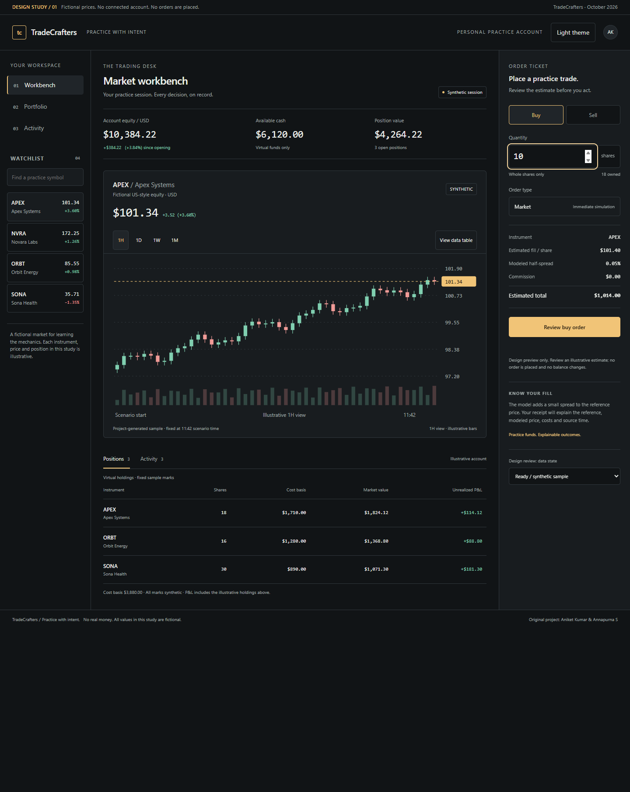
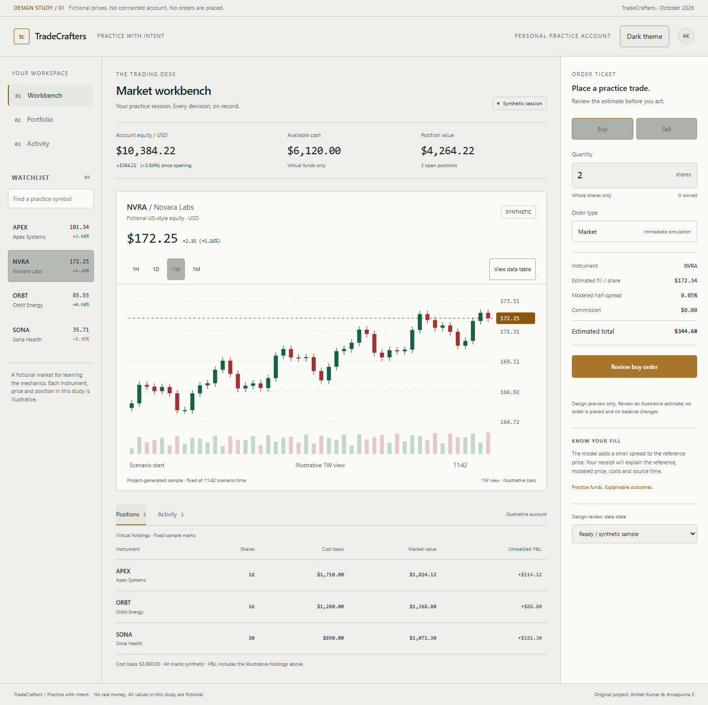
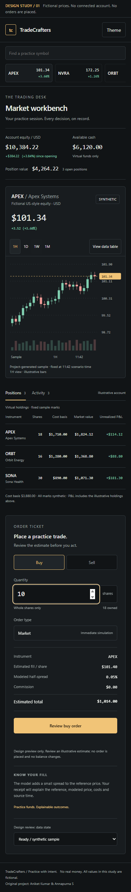

# Workbench design study

An original visual direction for TradeCrafters: graphite surfaces, warm amber focus, a dominant chart, a compact watchlist, a focused order ticket, and clear account records. The proposed app retains creator credit for Aniket Kumar and Annapurna S.

**This is an interactive design document, not the upgraded trading application.** All instruments, prices, positions, and account values are fictional. No backend, sign-in, persistence, external data feed, or trading endpoint is connected.

**Global scope:** the product targets all stock exchanges. This study illustrates one fictional USD listing/workbench view; global exchange discovery, native-currency wallets and FX flows still need design and verification. See the [global architecture](../architecture/global-markets.md). These screenshots are not evidence of worldwide data or trading support.

The later [M3 application implementation](../implementation/workbench.md) now combines venue-qualified discovery, authored chart/table, a native ticket and M2 accounting at `/trading`. The HTML study below remains historical design evidence. Real student walkthroughs are still deferred; use the [prepared protocol](student-walkthrough.md) for the remaining M3 acceptance.

Open [workbench.html](workbench.html) in a browser, or serve the design folder locally from the repository root:

```text
python -m http.server 8765 --bind 127.0.0.1 --directory docs/design
```

Then open [the local workbench](http://127.0.0.1:8765/workbench.html). This URL works only while the local server is running. No package installation or API key is required for the study.

Try selecting an instrument, searching the watchlist, switching Buy/Sell, changing quantity, reviewing the preview, switching chart/table views, using the keyboard tabs, toggling light mode, and previewing stale/closed states. Review never places an order. The underlying application must implement the [domain rules](../architecture/trading-and-data-model.md) before this can become a trading product.

## Desktop



## Light theme



## Mobile

Mobile uses a scrolling watchlist, single-column layout, a chart with fewer readable candles, a contained positions table, and a separate order-ticket section.



Read the [product/design specification](../research/03-product-and-experience.md) and [verification record](../research/evidence/verification.md). Student usability sessions and a formal accessibility audit remain future work.
