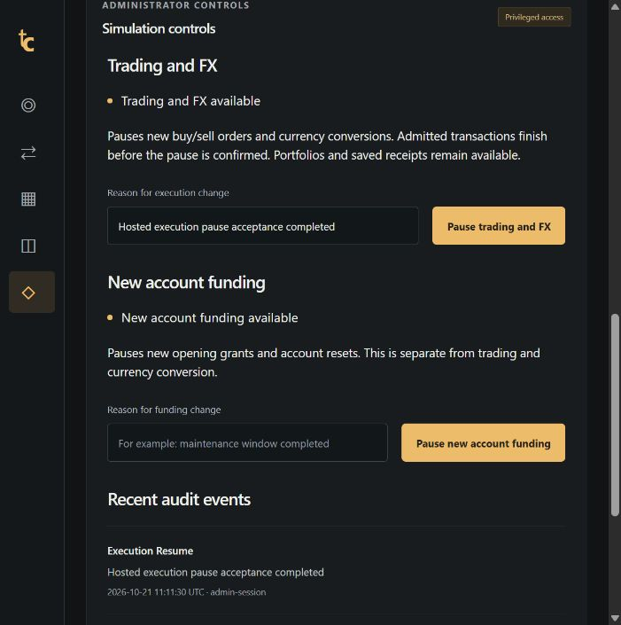

# Hosted demo provisioning — 21 October 2026

**Historical provisioning record. M4/#6 is now accepted**; use the [final release record](m4-acceptance.md) for current status. The initial Singapore/46-connection observations below predate the approved Free move to Bangalore/76 connections and Vercel Mumbai alignment. M3 student feedback remains deferred and all real feeds remain disabled.

## Database evidence

The following checks ran from the operator machine against the actual Aiven service on **21 October 2026 UTC**. They do not establish access from Vercel Functions.

| Check                  | Observed result                                                                                                                                                       |
| ---------------------- | --------------------------------------------------------------------------------------------------------------------------------------------------------------------- |
| Service                | MySQL 8.4.11, DigitalOcean Singapore (`sgp`)                                                                                                                          |
| Schema                 | Eight migrations, checksum recheck and seed completed; 46 tables, 2,889 MIC reference rows and ten fictional listings                                                 |
| Initial accounts       | Zero users at provisioning; no hosted financial operations were created by these checks                                                                               |
| TLS                    | Valid CA and hostname accepted; wrong CA and wrong hostname both rejected with `HANDSHAKE_SSL_ERROR`                                                                  |
| Runtime permissions    | Exact table/column grant contract matched; reads of migration history and MySQL account metadata denied; updates to roles, operation receipts and cash entries denied |
| Server capacity        | Actual `@@max_connections` was **46**; use this measurement rather than the earlier provider baseline of 76                                                           |
| Enforced identity caps | Runtime 12, migration 2, operator 2, each requiring TLS                                                                                                               |
| Runtime pool           | Two connections per process; six full pools fit within the shared runtime cap                                                                                         |
| Capacity reserve       | 16 connections reserved; the three identity caps plus reserve total 32, leaving 14 unallocated                                                                        |
| Actual cap exercise    | Seven independent pools requested two connections each: **12 accepted, two rejected** by the server user limit; all were released, with no financial mutations        |

Provisioning/grant evidence was recorded at `2026-10-21T02:18:18Z`; the capacity exercise at `2026-10-21T02:19:39Z` took 455 ms. These are connectivity and admission checks, not request-throughput or latency guarantees. A runtime cap protects server capacity but does not prevent request abuse. Other deployments using the same identity share its cap; additional identities require a combined budget review.

The original empty provider database was preserved. Credentials, auth secrets and private operator reports remain under ignored `.local/hosting/`; none belongs in Git or application responses. Provisioning was an assisted provider-specific operation, not a new generic provisioning command.

## Changes required by the actual service

The MySQL driver needs both `rejectUnauthorized: true` and `verifyIdentity: true`. The latter explicitly enables hostname verification; the previous configuration verified the certificate chain without explicitly enabling the driver's hostname check. The shared pool now sets both. Actual negative probes against the hosted service rejected a wrong CA and a wrong hostname.

Aiven returned grants with ANSI double-quoted identifiers. The release inspector now accepts correctly paired double quotes as well as backticks while preserving exact schema, table and column permissions. A regression check rejects another schema and mismatched quotes; wildcard, extra and inherited-role grants remain rejected.

`apps/web/vercel.json` selects Singapore Functions (`sin1`) to match the database. The deployment build region is independent of the Functions region. Deployed requests subsequently reported `sin1`. See [Vercel's region configuration](https://vercel.com/docs/functions/configuring-functions/region).

## Serverless connection lifecycle

After the owner saved Production variables, deployment `Bnm6o3GMjp1etKboEAW1s4xCBhob` built successfully from `38c65c7`. Public database-backed routes still failed. Its runtime logs identified the enforced user limit; an operator inspection found **12 sleeping runtime connections, zero active queries**, with idle ages of 120–170 seconds. The connection ceiling was working, but released connections from warm/suspended Functions were retaining all admission slots.

The shared pool now sets `maxIdle: 0` and a five-second idle timeout. This explicitly enables mysql2's reaper even for a one-connection pool; its next one-second sweep closes released sockets. Checked-out connections remain available to their work. The pinned Vercel Functions helper attaches to the actual pool's release events and holds the request context open for cleanup before suspension. Its documented event/idle interface is used because this SDK version otherwise detects the raw mysql2 config as the legacy MySQL shape and uses a 60-second default. See [Vercel pooling guidance](https://vercel.com/kb/guide/connection-pooling-with-functions).

Production sessions also set their own `wait_timeout=60` as a server-side idle backstop if a process is suspended or lost. This is an idle-session ceiling, not a query execution deadline; a transaction abandoned while idle can be rolled back by the server. Financial requests retain their existing transactional/idempotent recovery contract. The runtime user cap stays at 12.

A new local MySQL regression fixture exercises a one-connection production pool with the actual Vercel helper and a simulated request context: checked-out work survives beyond the pool idle timeout, released sockets disappear before the helper's wait resolves, and a subsequent query reconnects. Local lifecycle verification does not substitute for hosted acceptance; the subsequent deployed results are recorded below.

## Hosted browser checkpoint

PR #23 passed 129 checks and deployed commit `a5724ed` to Production as `71ENnohcAa1gcZ96FhVJudpp41Ff`. At **2026-10-21T02:51:55Z**, home, sign-in, the 2,889-row directory and the fictional chart returned valid `200` responses; an anonymous portfolio request correctly returned `401`. Responses were uncached and runtime routing showed `sin1`. A subsequent operator inspection found **zero retained runtime connections**. The guarded old-connection cleanup found no eligible sessions and closed none; old deployment connections had already retired.

The owner completed hosted GitHub authorization. The intended-domain callback, verified provider identity and session persistence across reload passed. The hosted account received one 100,000 USD virtual grant; buying one fictional KITE share at 184.42 USD produced a saved receipt, 99,815.58 USD cash and a matching one-share position with 184.42 USD basis. This is synthetic acceptance evidence, not a real market transaction or performance claim. Administrator provisioning was completed separately after the identity and factor checks below.

The next browser check exposed a client timing bug: the local clock was about two seconds behind the server, so the FX preview rejected a newly issued quote as future and displayed an expiry/amount error. PR #24 deployed `4265943`: preview arithmetic uses server issuance time, while a monotonic request clock budgets its lifetime conservatively by subtracting the entire round trip. A timer clears an expired review. The server's stored-quote/current-time/account checks remain authoritative and unchanged. Regression checks cover skew, the exact expiry boundary, late/invalid timing, wrong-account and dust amounts.

The deployed browser check then converted **100 virtual USD to 80 GBP** and bought one fictional **ATLS / XLON** share at **1249 GBX / 12.49 GBP**. Reload preserved both positions and all three operation receipts; Activity reopened the GBP receipt from the server. Native cash was 99,715.58 USD and 67.51 GBP. A separate unexecuted FX review expired automatically, removed its confirmation button and offered a fresh review. Read-only hosted reconciliation at `2026-10-21T03:22:55Z` found one account, two wallets, five balanced journals, two matching positions/fills and three operations, with zero wallet or position discrepancies. This records the synthetic hosted journey; controlled lost-response, provider-outage and recovery acceptance remain separate.

The first authenticator attempt occurred after the session's ten-minute security-settings window. The server correctly returned `403 REAUTH_REQUIRED`; the auth SDK retained the application's nested error envelope, but the component read only a flat message and displayed a generic setup failure. Security settings now preserve both supported error shapes so the fresh-sign-in instruction reaches the user. Sign-out, a fresh GitHub callback and private owner-assisted factor enrollment completed; the verified factor and repository-owner provider identity were checked without exporting secrets. The owner then completed the separate five-minute current-session proof. At `2026-10-21T03:27:32Z`, operator-side verification matched the repository owner's GitHub identity, verified email and enrolled factor, checked the live session proof, and explicitly assigned the administrator role through the audited CLI workflow. Reload displayed Administrator and loading funding controls succeeded. One `admin_grant` audit event was recorded; no funding pause was toggled. The ten-minute settings freshness and five-minute privileged-request expiry remain enforced. After the proof expired, the privileged API returned `MFA_REQUIRED` without its control payload, and a reload hid the Load controls action until a fresh code is verified. Factor recovery and revocation drills remain open.

## Operator permission alignment

The initial operator identity could read the verified user but MySQL rejected the role workflow's `SELECT ... FOR UPDATE`. [MySQL 8.4 locking-read requirements](https://dev.mysql.com/doc/refman/8.4/en/innodb-locking-reads.html) require an additional write/locking privilege. The dedicated operator received only `UPDATE(id)` on `user` for that lock, `UPDATE(user_id)` on `admin_roles` for the idempotent role insert, and `DELETE` on `mfa_stepups` for role revocation. Existing operator role-insert/delete and audit-insert permissions remain. This is trusted operator access; the ID-column update privilege is real and must never be copied to the web identity.

A non-mutating, rolled-back permission probe verified the user-row lock and revocation statement. Unrelated MFA-setting, cash-entry and operation-receipt updates remained denied. The restricted web identity's exact-grant/TLS/denial preflight passed again after alignment. No new runtime, schema-wide write or global privilege was granted. This provider-specific correction is recorded for future reprovisioning; it does not add a general provisioning command or claim a completed revocation drill.

## Private environment handoff

The stable demo alias is served from Vercel's **Production environment**, even though the project name contains “preview.” Configure its credentials only for that environment. Unreviewed Preview/fork deployments must not receive this database identity or auth secret.

1. Create a separate hosted GitHub OAuth app. Homepage: `https://tradecrafters-preview-gamma.vercel.app`. Callback: `https://tradecrafters-preview-gamma.vercel.app/api/auth/callback/github`. Keep the existing local OAuth app unchanged.
2. Save its client ID and secret privately in ignored `.local/hosting/github-hosted.env`. The owner supplied the separate hosted pair and runtime preflight passed. Never paste credentials in a GitHub issue or chat.
3. Complete the generated `.local/hosting/preview-web.env` runtime handoff and run the [hosted preflight](deployment-foundations.md#commands). It contains only the restricted database connection, fresh hosted auth secret, exact HTTPS origin, hosted OAuth pair, verified TLS/inline CA and connection budget. Do not import admin, migration or operator environment files into Vercel.
4. Import the runtime variables into the project's **Production** environment and mark the database URL, auth secret and OAuth secret as Secret. Preserve the complete multiline CA. Redeploy a reviewed commit; environment changes do not update an existing deployment. [Vercel environment variables](https://vercel.com/docs/environment-variables).
5. Verify access from Vercel, then complete sign-in/reload/revocation and the native trade → receipt → portfolio → FX journey. Provision hosted admin/factor/recovery separately after verifying the owner's hosted identity.

The connected Vercel integration could list this project but returned a missing-team-grant error for project/deployment inspection. The owner imported Production variables; an authenticated dashboard session allowed a normal Production redeploy. No secret readback or connector upload is claimed. Do not overwrite either existing local env file with hosted values.

## Subsequent execution-control rollout

The initial hosted checkpoint above had a funding-only pause. PR #26 merged the independent [execution pause](execution-pause.md) as `9767f1a` after required CI passed **138 checks (57 domain/configuration + 81 integration)**, build, audit, encrypted recovery and container verification. Production deployment `3dCo6hH3tjRmchzdVsv8rBHuVhjY` succeeded.

Before application rollout, migrations `0009`–`0011` brought the hosted schema to eleven completed/checksummed migrations. Both trigger bodies/definers matched the reviewed source. The migration identity received `TRIGGER` only on `orders` and `fx_conversions`; runtime grants/caps stayed unchanged and TLS/grant/denial preflight passed again. Financial row counts and the original funding state were preserved. Actual Aiven guard probes rejected order/FX inserts inside a rolled-back transaction with no committed pause or financial records.

After the owner privately renewed the five-minute session proof, the hosted UI paused execution at **2026-10-21T11:10:15Z**. A fictional buy and virtual FX request each returned a durable `EXECUTION_PAUSED` rejection. Existing GBP fill details remained accessible from server-sourced Activity. Execution resumed at **11:11:30Z**, with separate reasoned `execution_pause` and `execution_resume` audit events. Funding remained available throughout. Reload retained two positions and five receipts; no new successful trade or conversion was performed during this exercise.

Read-only reconciliation at **11:12:39Z** confirmed five balanced journals, two wallets, two matching positions/fills and five operations, with zero discrepancies. Native cash stayed **99,715.58 USD and 67.51 GBP**. The two added operations are rejection receipts; the original three completed operations are unchanged. A separate operator check confirmed both flags available and exactly one matching pause/resume audit pair. This closes the hosted execution-pause walkthrough, not the remaining M4 release gates.

The local/CI recovery rehearsal now verifies that restored database guards actually reject inserts, in addition to matching 46 tables / 5,955 rows. This remains disposable-fixture evidence; provider restore, independent custody and hosted rollback acceptance stay open.

## Persistent request-admission rollout

PR #28 merged as `67ffa25` after all **153 checks (64 unit/configuration + 89 integration)** and required release gates passed. Production deployment `6TnTwL3kDFLZChGNao2P94dDZJed` was verified ready on the stable domain. Additive migrations 0012–0015 brought Aiven to **15 completed migrations / 48 tables**; exact event bodies/definers, indexed auth expiry, restricted web grants and TLS/cap preflight passed before merge. A stale schema-privilege connection required an inspected, checksummed completion of the first event migration; no history, passwords or financial records were rewritten.

The bounded hosted exercise rotated four forwarding headers across 192 invalid directory reads at concurrency four: **180 validation 400s, then 12 admission 429s**, one network row, uncached retry responses, a HEAD denial and a 307 directory redirect to the authored 429 page. Health and separate auth/write scopes remained available; admission and the browser's normal signed-in journey recovered at the next window. The original operator expiry poll timed out and is retained in the evidence. A separate two-row expired-counter fixture verified database-only idle cleanup in **27767 ms**, with both jobs executing and no identity/financial rows created. Read-only accounting still found five balanced journals, two wallets, two matching fills/positions and five operations; both pause flags are available.

See the [contract, limits, screenshot and interruption disclosure](request-admission.md). This is application admission on Vercel; valid-query throughput, DDoS protection, broader identity retention and non-Vercel proxy readiness are not established by this probe.

## Hosted callback and session verification

PR #30 made SDK success/error/redirect responses consistently no-store. PR #31 adds authoritative sign-out confirmation after a local fixture-only deletion fault reproduced false success with a still-valid session. The guard returns retryable 503 without clearing cookies when deletion/confirmation is uncertain, and preserves idempotent recovery. Required CI passed **156 checks (64 unit/configuration + 92 HTTP/MySQL)** and the existing build/audit/recovery/container gates.

Production `AtjZ88LJm9LcqzCHpQUXEkjVc9Jm` was verified against `c600ed96b14ab9fb2d3ac19253f224ff0001cdc5`. All **14 scoped HTTPS checks** passed again at **2026-10-21T13:49:38.037Z**: state/callback failures and restart, secure host-only state cookies, exact trusted redirect destinations, fixture session isolation/expiry/freshness, scoped revocation, retained-cookie denial and discarded sign-out response recovery. Rate limits were honored. Two synthetic server-issued session identities were deleted with exact fixture guards; no provider, factor, role, simulation/funding or financial records were created. Existing owner/session/role/factor/audit and financial/control counts were unchanged.

The [full record](hosted-identity.md) distinguishes these fixtures from real provider identity, a live GitHub/Aiven outage, financial lost-response acceptance or owner factor recovery. The owner's previously verified browser session was left intact.

## Subsequent release acceptance

[M4 acceptance](m4-acceptance.md) now records hosted response-loss recovery, measured capacity/overload, independent owner recovery, encrypted hosted restore, independent custody/audit anchoring, lifecycle/expiry, actual Free cost/location, CSP/monitor and compatible rollback/promotion. Provider PITR was unavailable; portable isolated recovery is the tested application path. Non-Vercel ingress, real feeds and worldwide capability completion remain future work. Creator attribution remains **Aniket Kumar and Annapurna S**.
