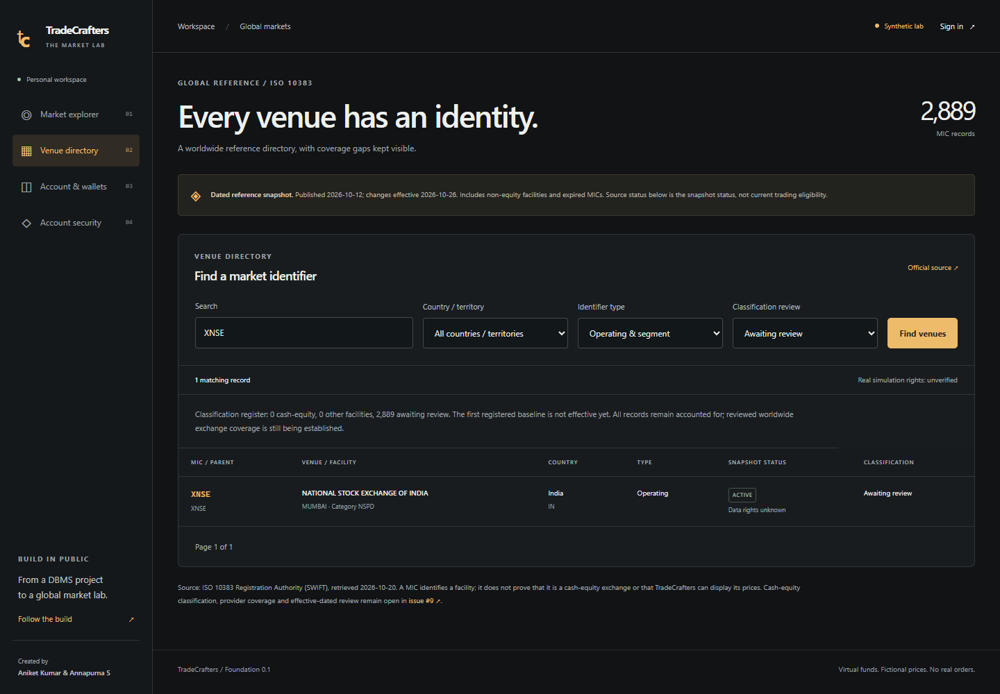
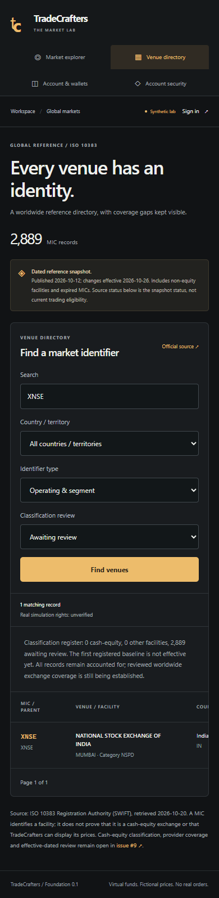

# M1 foundation acceptance — 20 October 2026

M1 establishes a reproducible global application and verified identity with market/currency/policy contracts. This record maps the [original M1 deliverable and exit criteria](../ROADMAP.md#m1-foundation) to implementation evidence. The required PR checks must pass and the change must merge before issue #3 is closed.

M1 was merged and #3 closed. This is its historical 80-check baseline; subsequent order execution, FX posting and archive/reset are documented in [M2 acceptance](m2-acceptance.md).

| M1 requirement                                                                                 | Evidence                                                                                                                                                                                                           |
| ---------------------------------------------------------------------------------------------- | ------------------------------------------------------------------------------------------------------------------------------------------------------------------------------------------------------------------ |
| Fresh-clone setup, pinned stack and tracked database code                                      | Node 24 workspaces, exact lockfile, one checksum-checked SQL history, repeatable setup/seed, required clean-install MySQL CI and tracked-source checks                                                             |
| Server identity, sessions, revocation, ownership and bounded trusted-origin requests           | Owner-assisted local GitHub callback/reload verification; database-backed sessions and limits; strict input/origin/CSRF/ownership checks; production configuration rejects local passwords and non-HTTPS origins   |
| Explicit administrator bootstrap and MFA                                                       | Verified owner enrollment and operator grant; current-session authenticator proof, replay/attempt budgets, immediate revocation and transactional audited funding controls                                         |
| Global venue/security/listing identity and effective provider mappings                         | Complete dated MIC reference, immutable source versions/diffs, operating/segment relationships, distinct cross-venue symbols, dated alias locks/overlap rejection and current-server-date lookup                   |
| Native wallets, exponents, quote units, opening grants and FX contracts                        | Twelve supported currencies, zero/two/three exponents, GBX/ZAC conversion, exact integer arithmetic, one immutable grant/journal, empty additional wallets and account-bound FX quote/rounding contracts           |
| Local calendars/rules and capability-register contracts                                        | Immutable effective policy versions, permission/expiry/halt gates, DST/overnight/break/holiday/session/lot/tick/band checks, provider/dataset/feed/audience/use capability contracts and explicit unknown coverage |
| Isolated multi-region fixtures, source/dependency review and historical credential disposition | Ten fictional listings across six regions; disposable integration fixtures; separate restricted web DB identity; root audit and credential-pattern checks; owner-confirmed historical rotation/revocation          |

## Verification record

The suite contains **29 domain/configuration tests and 51 integration checks: 80 total**. Integration checks use real MySQL 8.4 and the running HTTP app, plus the actual authentication handler with isolated provider transport fixtures. They cover financial grant concurrency, session and MFA boundaries, operator authorization, alias races/reuse, source immutability and dated promotion, classification expiry, capability scopes, corruption and actual database privilege denials.

The seven OAuth fixture checks cover missing/forged/expired/browser-mismatched state, user denial, token/profile outages, consumed-state replay, fresh retry/reload/sign-out recovery and rejection of untrusted callback origins. They use fresh test-only credentials/identities and make no live provider request. They complement the earlier owner-assisted real GitHub sign-in; they do not establish a deployed HTTPS callback.

Node 24 type checking, lint, formatting, source-pattern checks, production compilation and the workspace dependency audit pass locally. Required GitHub CI repeats clean installation, migrations, seed, restricted DB identity provisioning and all tests/build/audit checks. Legacy dependency advisories remain visible and outside the deployed v2 application scope.

The directory's search and classification selection were checked in a fresh browser at 390, 768 and 1,440 pixels without page overflow. The reference dates, unknown classification counts and disabled real rights stay visible. Browser console: zero errors and zero warnings. Anonymous previews contain no account, session or factor data.

## Credential disposition

On 20 October 2026, the owner confirmed in this chat that the historical Alpha Vantage/database credentials were revoked or rotated. This is owner attestation; no issuer-side rotation or activity audit was independently performed by the application or agent. No historical credential was imported into v2. Local secrets were generated afresh and remain ignored. Historical source/artifacts and dependency alerts remain available as audit evidence; they are not approved for deployment.

## Milestone boundary and remaining work

M1 acceptance covers the foundation/contracts described above. The complete worldwide real-market objective remains unchanged. The prior slice status listed deployment and real-coverage dependencies alongside foundation work; their delivery and acceptance continue under these existing milestones:

| Follow-up                | Required work still open                                                                                                                                                            |
| ------------------------ | ----------------------------------------------------------------------------------------------------------------------------------------------------------------------------------- |
| M2 / #4                  | Orders, fills, positions, receipts, idempotent ledger posting, executable virtual FX and reporting valuation                                                                        |
| M3 / #5                  | Full trading workbench, chart/order/portfolio flows, broader keyboard/accessibility review and student walkthroughs                                                                 |
| M4 / #6                  | Hosted HTTPS OAuth callback/operator provisioning, production DB/TLS/ingress privileges, load/connection budgets, backups/restore, recovery operations and external audit retention |
| M5 / #7 and inventory #9 | Evidence-backed real venue/listing/calendar/rule/provider capabilities, rights, quota/freshness/outage checks, real-data enablement and remaining cash-equity classification        |
| M7 / #9                  | Reviewed worldwide denominator, smaller/frontier and non-MIC gaps, and per-venue rollout until the original global objective is met                                                 |

All 2,889 current MIC reference records remain awaiting classification review; there is no verified real-data integration and no public deployment. Source snapshots and fictional training policies demonstrate the contracts, not real exchange eligibility. The October source changes become effective on 26 October, and no prior effective baseline was fabricated. These limitations remain visible in the product and GitHub inventory tracking.
