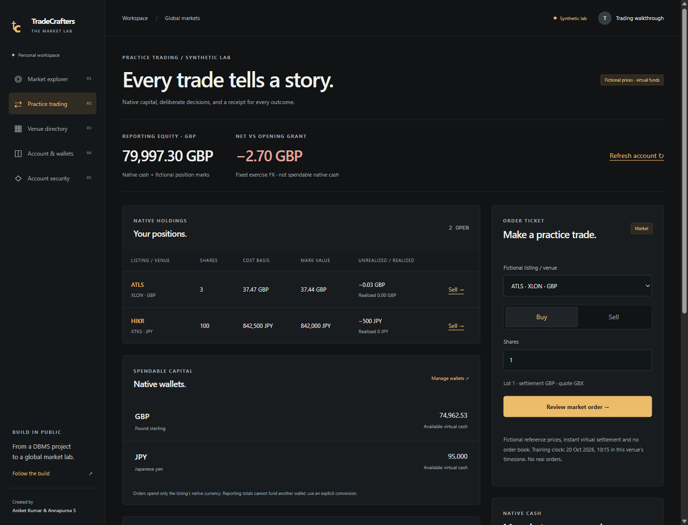
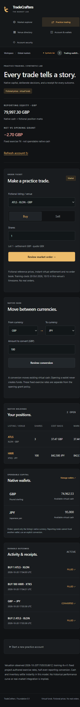

# M2 trading acceptance — 20 October 2026

M2 implements the [multi-currency trading slice](../ROADMAP.md#m2-trading-integrity): authenticated fictional quote → native fill/journal → holdings and durable receipt, plus explicit FX and archive/reset. [Issue #4](https://github.com/DuhItzAniket/TradeCrafters/issues/4) closes only after required CI and merge. The [implementation contract](trading-accounting.md) records clocks, model limits, APIs, locking, recovery, migration and rollback.

| Requirement                               | Implementation and evidence                                                                                                                                                                                               |
| ----------------------------------------- | ------------------------------------------------------------------------------------------------------------------------------------------------------------------------------------------------------------------------- |
| Server identity, ownership, strict intent | Live sessions and origin checks, account ownership on reads/writes, bounded strict bodies; forged prices/clocks/ownership and foreign account/receipt access denied                                                       |
| Native prices, exponents and venue rules  | Exact 5 bps/tick model; all ten fictional listing policies; JPY/KWD exponents and GBP pence; lot/band/cap/quote-account bindings and fixed local training session                                                         |
| Atomic posting and durable idempotency    | One checked-out connection and account lock; concurrent identical keys return one fill; changed-body conflicts; immutable source/model/policy/FX provenance                                                               |
| Native journals and explicit FX           | Per-currency two-entry reconciliation; linked FX journals; source funds cannot be spent concurrently by FX and a buy; no implicit conversion or wallet grant                                                              |
| Positions, basis and reporting            | Independent persisted-fill reconciliation to quantities, cost basis and realized P&L; partial/final liquidation; reporting exponents/source/time/rounding; unavailable mark propagates incomplete equity                  |
| Failure and race recovery                 | SQL failure after writes rolls back; owned child process killed before commit leaves no partial accounting; response discarded after commit recovers the original receipt; expired quotes after account waits cannot post |
| Reset and session revocation              | Reset/order races preserve history and one new grant; old receipt replays remain stable; one active account, hourly reset limit and funding pause; revoked sessions cannot mutate through a previously checked actor      |
| Reviewable interface                      | Native ticket, buy/sell review, separate conversion, holdings, activity/cursor, provenance receipts, pending-intent reload recovery and archived-account navigation                                                       |

## Automated verification

The final verification uses Node **24.22.0**, MySQL **8.4**, the actual Next development HTTP routes and the restricted web database identity. Commands are in the [local guide](local-development.md). Results:

- **38 domain/configuration checks**: the 29 M1 checks plus nine trading checks for exact half-even money, model prices/tick transitions, all regional quote units, lot/band/cap bindings, freshness, proportional basis and reporting FX.
- **70 HTTP/MySQL integration checks**: the 51 M1 checks plus 19 trading checks for ownership, fills, duplicates, cash/inventory races, FX, failure recovery, resets, quote expiry while waiting, unavailable marks, revocation and stable receipt pagination.
- Type checking, lint, formatting, tracked-source/credential-pattern checks, production compilation and the new workspace dependency audit are required. A zero-advisory new-workspace audit does not clear the separate legacy findings.

Trading tests use isolated random local identities/accounts and remove only their own records. Failure tests install account-scoped disposable triggers using the local Docker test operator, then remove them; runtime permissions and MySQL global safety settings are not loosened. A named-lock barrier proves the child transaction is blocked before the process is terminated. Reconciliation checks sum actual persisted journal entries and fill definitions rather than trusting portfolio output alone. OAuth fixtures make no live provider request.

The combined run initially exposed a test matcher that accepted table-level permission denial but omitted MySQL's column-level denial code for immutable account metadata. The database denied the write correctly; the matcher now explicitly recognizes that denial and the focused privilege checks pass. Final counts refer to the subsequent full passing run.

## Browser → API → MySQL → receipt

A disposable “Trading walkthrough” identity was created through the normal local sign-up UI; no owner credentials, account exports or authenticator screens appear in screenshots. Verified in Chromium:

- GBP-funded ATLS/XLON buy, partial sale and final liquidation settled pence quotes into pounds with zero residual basis. Explicit GBP→JPY conversion funded a 100-share HIKR/XTKS lot; JPY quantities and native balances remained exact across reloads.
- The UI obtained a quote and confirmed a trade using keyboard Enter; the holdings table can receive keyboard focus and scroll horizontally with arrow keys. Inputs have visible labels, receipts announce updates and errors use alerts. This is focused keyboard QA, not a complete assistive-technology audit.
- A deliberately aborted response after upstream 201 left the pending intent/key. Reload retained the recovery panel; recovery showed the original fill exactly once, cleared the local pending record and unblocked trading. Confirmed trade/FX review controls cleared after submission.
- Typed `RESET` and keyboard confirmation created a new GBP account with one 80,000 GBP grant. Previous/next links retained two old positions and opened the original receipt; archived trading controls were disabled. Owner accounts and roles were untouched.
- At widths **390, 768 and 1,440**, document scroll width equaled the available client width (**375, 753 and 1,425** with the browser scrollbar). The wide table scrolls internally. The initial mobile accessibility-label overflow was fixed at its positioned container. A fresh, non-injected page recorded zero console errors and warnings; the deliberate aborted response produced its expected network error during recovery testing.

## Remaining milestone boundaries

M2 is a local synthetic accounting milestone. It does not claim realistic liquidity, a live/historical price chart, actual student usability observations, accessible screen-reader certification, public HTTPS readiness, managed backup restoration or real exchange entitlements. The historical [M1 acceptance](m1-acceptance.md) remains valid for its own 80-check baseline.

M3/#5 still owns the full discovery/chart workbench and student walkthroughs. M4/#6 owns public deployment and operational verification. M5/#7 and #9/M7 own evidence-backed real feeds/rules and the reviewed worldwide inventory; all 2,889 reference records remain unreviewed and real trading coverage remains zero. M6 owns durable resting orders. No paid or public resource was provisioned for M2.
