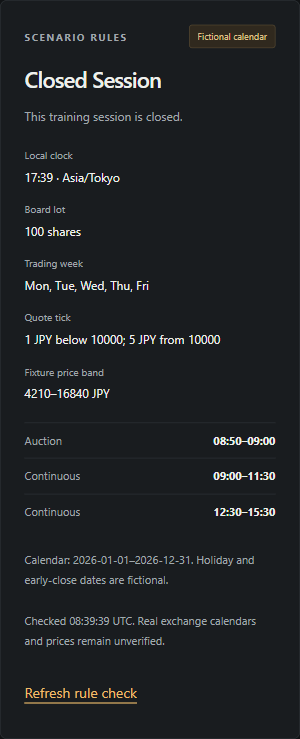
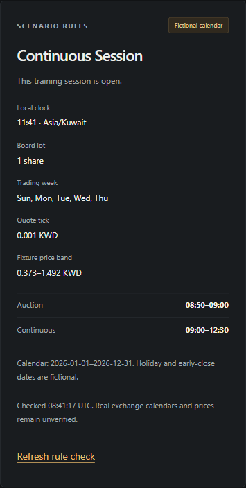

# Versioned market policies — 20 October 2026

This M1 implementation adds persisted calendar and trading-rule versions, dated listing assignments, permission checks and listing halts. It supports the global simulator's foundation; it does not enable orders or certify any real exchange's rules. All ten seeded policies are **fictional training scenarios**.

## Storage and publication

Migration `0005_market_policies.sql` adds calendar versions, rule versions, effective listing assignments, per-assignment permissions, listing halts and a publication audit. Existing migrations and the legacy coursework database are unchanged. The older `fixture_policy` field remains for compatibility; policy reads use the new tables.

`publishListingPolicy` is a trusted server/database operation. There is no public policy-writing endpoint. It validates the complete bounded calendar horizon before opening a transaction, then locks the existing listing and security before checking effective-period overlap. Assignment, immutable definitions, permissions and audit commit together. Eight concurrent identical publications produce one assignment and one audit record. Reusing a definition ID with different content fails; adjacent assignments are allowed. Content hashes use canonical JSON and SHA-256. These hashes detect inconsistent stored content; they are not signed evidence or a substitute for database access controls.

Effective assignments and halts use UTC millisecond instants with inclusive starts and exclusive ends. Calendar coverage uses local dates with an exclusive end. Definitions are limited to 1–1,096 covered days, eight sessions per day and 400 dated exceptions. Holiday exceptions replace a day's sessions with an empty list; early-close exceptions replace the entire day's schedule. Overnight sessions retain their starting trading date even when they finish on a weekend or holiday.

Session boundaries resolve in the listing's IANA timezone. Ambiguous or nonexistent DST boundaries are rejected at publication, as are overlaps across trading dates. This uses the [Temporal polyfill](https://github.com/js-temporal/temporal-polyfill) with explicit rejection of [timezone ambiguity](https://tc39.es/proposal-temporal/docs/timezone.html). The deployed Node/ICU timezone database still matters: runtime or timezone-rule updates require review. Before executions exist, M2 must retain the policy IDs and resolved UTC boundaries used for each decision.

Rules represent whole-share board lots, maximum quantity, exact decimal quote precision, a contiguous tick ladder, inclusive fixed price bands and market-order type validation. Integer arithmetic avoids floating-point tick comparisons. Auction windows are represented but do not permit continuous-session eligibility. Odd-lot facilities, dynamic exchange bands, closing auctions, limit/stop orders, corporate actions and venue-specific exceptions beyond this model require later work.

## Read API and permission gates

`GET /api/listings/:listingId/policy` uses the server clock, returns `Cache-Control: no-store` and rejects query parameters. A caller cannot supply a timestamp, data mode, policy version or fill price. Unknown listings return 404; mutations are not supported.

The read requires exactly one effective assignment, consistent definition IDs/hashes, matching listing timezone and data mode, and current verified display **and** simulation permission. Real mode additionally requires reviewed provenance and a verified venue capability. Unknown, blocked, future or expired permissions deny access to policy details. Missing or conflicting assignments, invalid definitions, uncovered dates, halts, auctions, breaks and closed sessions leave session eligibility false. A halt affects only its own listing.

`sessionEligible` reports whether these preliminary session gates allow a continuous session. It does not validate an order or promise an execution. `executionAvailable` and `realDataEnabled` remain false in every response. The separate exact rule checker must eventually be combined with a trusted fresh quote, quantity validation, wallet/position locks, idempotency and balanced transaction journals in M2. This slice accepts no orders and changes no account balances.

## Fictional fixtures

The seed publishes ten synthetic policies alongside the existing fictional listings across six regions. It includes JPY and KWD precision, GBX/ZAC quote units, split sessions, independent London/Sydney DST behavior, and Sunday–Thursday training weeks. Repeating the seed preserves policy identities and never changes real-simulation capability records from unknown.

Coverage runs from 1 January through 31 December 2026. **21 October is an invented training holiday and 22 October an invented early close.** The times, lots, ticks and fixed bands are scenario settings, not reviewed exchange rules. Fictional display/simulation/replay permission covers our own fixtures only and expires on 1 January 2027. Extending coverage requires new reviewed version IDs and assignments; do not edit definitions already seeded into a retained database.

The explorer shows the selected scenario's local clock, week, board lot, ticks, fixed band, current trading-day windows and coverage dates. It labels both the calendar and prices as fictional and offers a fresh server check.

## Verification

- 16 domain tests cover existing money helpers plus calendars, DST gaps/folds, overnight dates, holidays, early closes, split sessions, exact lots/ticks/bands and invalid definitions.
- 27 HTTP/MySQL integration tests cover the account-security foundation plus concurrent/idempotent policy publication, immutable versions, effective boundaries, halts, conflict detection, corruption, permission expiry, real-mode denial, server-clock reads and repeat seeds.
- Policy integration fixtures use a disposable random listing/security and remove only their own records. No real account is granted funds or administrator rights by these checks.
- Node 24 type checking, lint, format checking, production compilation and the new workspace dependency audit are included in the required GitHub `verify` job. Legacy dependency findings remain separate.

Browser → policy API → MySQL → panel was verified in a fresh Chromium session. Selecting Hikari shows Japan's fictional 100-share lot, two continuous windows and tiered JPY ticks; selecting Pearl replaces them with the fictional Sunday–Thursday week and 0.001 KWD tick. Refresh updates the server check. At viewport widths 390, 768 and 1,440 pixels, document width never exceeded the viewport. The final browser console recorded **zero errors and zero warnings**. These are public anonymous fixture previews, without account or authenticator information:

 

This records the earlier policy slice. The later [M1 acceptance record](m1-acceptance.md) adds alias-overlap enforcement, inventory/capability contracts and identity failure/privilege verification. Reviewed real policies/entitlements and worldwide classification continue under M5/#9/M7; hosted identity/security and operational checks remain M4. See [foundation status](foundation-status.md) and [local setup](local-development.md).
