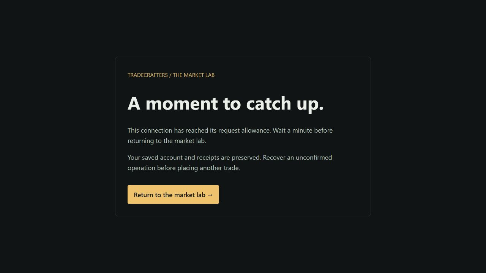

# Persistent request admission and counter expiry

Implemented 21 October 2026. This M4 slice protects database-backed application requests before authentication, validation and business queries. It adds no paid service. Hosted rollout and acceptance must be recorded separately below; local tests alone do not establish Vercel header handling or production capacity.

## Allowances and trust boundary

| Scope | Requests per network per minute | Requests across the service per minute |
| --- | ---: | ---: |
| Read: API GET/HEAD and server-rendered pages | 180 | 600 |
| Auth: every `/api/auth/…` request | 60 | 120 |
| Write: other application API methods | 60 | 240 |

These are fixed, database-clock minute windows, not rolling windows. A boundary can admit two allowances in a short interval. Shared NAT users share an IPv4 allowance; IPv6 uses a canonical /64 network. IPv4-mapped IPv6 is normalized. The service ceiling limits admissions even when subjects rotate. Rejected subjects do not spend the remaining global admissions. Allowances are intentionally conservative for the small synthetic demo and need representative-user/capacity measurements before a wider launch.

On Vercel, only `x-vercel-forwarded-for` supplies the network identity. Missing, malformed, comma-separated or zone-qualified values fail closed. Caller `Forwarded`, `X-Forwarded-For` and `X-Real-IP` never provide a production fallback. Better Auth uses the same selected header and /64 normalization, retaining its stricter endpoint-specific database limits. Vercel documents that its [platform header identifies the client independently of an upper proxy rewriting XFF](https://vercel.com/docs/headers/request-headers). Actual spoof-header acceptance remains a required deployment check.

Local fixture address injection uses XFF only with `AUTH_DEV_CREDENTIALS=true`, a loopback auth origin and a non-production process. An isolated OAuth test explicitly models Vercel headers with fake provider transport. **Other production ingress currently fails closed.** The standalone image remains portable, but AWS/container application readiness needs an explicit trusted proxy adapter and end-to-end spoof tests first. Setting `VERCEL=1` behind an arbitrary public proxy does not establish that trust contract.

## Persistence and failure behavior

Each admission locks one of three preseeded scope rows, then uses the database clock and a transaction to update both the network and service counts. It cannot create a scope from a path, account ID or arbitrary key. The counter identity is an HMAC of scope, window and canonical network, using the existing server auth secret; it changes each minute. New ingress tables contain neither raw addresses nor cookies/account IDs. This does **not** remove IP/path metadata from Better Auth's existing `rateLimit` table or identity/session records. No secret rotation is required by this release.

Admission uses READ COMMITTED for its next transaction only, a two-second InnoDB lock wait and at most two retries for a lock timeout/deadlock. It restores the connection's lock setting before returning it; an unrestorable connection is discarded. Existing financial transaction isolation is preserved. Database acquisition retains its separate two-second queue deadline. This bounds admission lock contention; it is not a universal SQL statement deadline.

API rejection returns uncached `429 RATE_LIMITED` with `Retry-After`; unavailable ingress/counter state returns sanitized `503 SERVICE_UNAVAILABLE`. The callback is never invoked on rejection. Financial idempotency and ownership/origin/factor checks remain independently required after admission. Recover a saved operation by its original key before repeating an uncertain change; a throttled receipt lookup can itself require waiting.

Page guards run before session/database reads. React request-local caching shares one admission between parallel root-layout/page work. Pages that query directly also guard themselves because layouts can be reused during client navigation. The directory's HTML and RSC requests are exercised over HTTP. Rejection navigates to `/request-status`, an authored, database-free 429/503 page. Next streaming redirects may travel in HTML/Flight rather than the original HTTP status; the destination carries the actual status and retry header. No counter decision is cached across requests.

`/api/health`, `/request-status`, static assets and unsupported methods without a handler do not touch the database and are outside these application budgets. These controls protect application work after reaching the function; they do not make rejected requests free, guarantee DDoS protection, replace platform protections, or establish normal-user throughput.

## Expiry, grants and restore

Migrations 0012–0015 add two tables, three fixed scope rows, two MySQL events and an indexed auth expiry column. The [MySQL scheduler](https://dev.mysql.com/doc/refman/8.4/en/events-configuration.html) must already be ON; application admission and runtime preflight fail closed if it is disabled. Deployment tooling verifies enabled event definitions/definers and observed execution. No global server setting is changed by the app.

- Every minute, `ingress_counter_expiry` removes up to 4,096 rows older than the preceding minute, even with no application traffic. Healthy cleanup normally removes a counter about 2–3 minutes after its window begins. Each admitted attempt also deletes up to 128 older rows in its scope.
- Admission has a hard retained-subject ceiling of `2 × service allowance + 1` per scope: 1,201 read, 241 auth and 481 write rows. A full scope rejects a new subject with 503. Together with three fixed control rows, this bounds storage through this code path even when expiry stops. It does not constrain a privileged direct database writer.
- `auth_counter_expiry` deletes at most 2,048 Better Auth counters older than five minutes each minute, using an index on `lastRequest`. Healthy physical expiry is approximately 5–6 minutes after the last request; this is separate from the SDK's one-minute decision window. Database/event failure can delay deletion, and backups have a separate retention policy. There is no unconditional deletion deadline or claim that all identity/audit data expires here.

The migration identity needs schema-scoped EVENT plus the table privileges needed by its event bodies. Keep this definer valid across credential maintenance and restore. The web identity receives only SELECT/column-limited UPDATE on control rows and SELECT/INSERT/UPDATE/DELETE on client counters, with no EVENT, control INSERT/DELETE or scope UPDATE privilege. Preflight checks the exact manifest. Runtime credentials cannot inspect/change event definitions.

Existing authenticated mutation/MFA budgets remain one row per identity, and step-up state remains one row per session with foreign-key cleanup. Used-code replay records are pruned on the next verification for that identity. These identity-bound records are outside the new anonymous-counter TTL; the broader account/security retention and deletion policy remains an M4 gate.

The encrypted local recovery drill now includes `mysqldump --events`, verifies both restored jobs are enabled with the intended target tables, and retains accounting, migration-checksum and execution-guard checks. Hosted restore must explicitly review event definers/privileges and observed execution; a container fixture does not establish provider recovery.

## Release and rollback

1. Pass required CI on the reviewed commit. Keep auto-merge off until schema preparation finishes.
2. Using the migration/operator identities, apply additive migrations, grant only the manifest's new table privileges to the web identity, recheck checksums/seeds/events/index/scheduler and prove existing financial counts and pause states unchanged. Preserve all passwords and environment files.
3. Run restricted hosted preflight. Enable ordinary protected-main merge, then verify the resulting Vercel Production deployment.
4. From one test connection, rotate forged forwarding headers across a bounded public read probe. Verify one network allowance, 429/no-store/retry behavior, expiry/recovery and unchanged financial aggregates. Do not publish addresses, counter digests, auth metadata or secrets. Record scope and timing; this probe is not a load-capacity benchmark.
5. Check the authored retry page and a recovered normal journey in a browser. Record actual hosted evidence before marking this item complete.

Rolling application code back leaves the additive tables, index and events intact. Older application versions bypass these new admission guards; a rollback therefore removes this protection and must be an explicit operational decision. Do not drop tables/events or delete migration history to perform an application rollback. Execution/funding guards and financial history remain separate.

## Verification record

Seven unit cases cover strict platform selection, fail-closed unsupported ingress, canonical IPv4/IPv6, invalid address rejection, HMAC separation, invalid secrets/windows and fixed request scopes. Eight HTTP/MySQL cases cover concurrent network ceilings, rotating subjects/global ceilings, database rollover, hard storage bounds, SSR/RSC single admission and retry UI, separate auth/write limits, liveness, missing control state, lock contention/default restoration, and idle event expiry. Additional privilege probes deny event creation and control-row expansion to the web identity.

PR [#28](https://github.com/DuhItzAniket/TradeCrafters/pull/28) passed required [CI](https://github.com/DuhItzAniket/TradeCrafters/actions/runs/39595548476) with **153 checks (64 unit/configuration + 89 integration)**, build, audit, encrypted recovery and container verification. It merged as `67ffa252cc1a5b7cef1780f3239c42fb16cf25e6`; Production deployment `6TnTwL3kDFLZChGNao2P94dDZJed` was verified ready on the stable demo domain. The reviewed tree equals the merge tree.

Before deployment, Aiven reached **15 completed/checksummed migrations and 48 tables**. Both enabled event bodies/definers and the auth index matched source; exact runtime grants/TLS/caps/denials passed. The initial EVENT grant needed a fresh MySQL connection: the incomplete 0013 marker and absent event were inspected, the exact checksummed statement was completed explicitly, and no history was deleted. Reconnect after schema privilege changes; do not blindly retry a partial DDL migration. Passwords, existing financial counts and pause states were preserved.

The actual hosted probe started at **2026-10-21T12:04:23Z**, waited for a fresh database window, then sent **192 invalid directory reads at concurrency four** while changing XFF, Vercel-forwarded, X-Real-IP and Forwarded on every request. It received **180 input-validation 400s and 12 admission 429s**, one new network row and no count above 180. All responses were uncached; a retry header up to 51 seconds was observed. HEAD returned 429; the directory returned 307 to the authored 429 page, which also appeared in the browser. Health stayed 200, anonymous auth still returned 200/null and the separate write scope still reached the origin-denial guard. The next database minute admitted the request again (observed **12:05:59Z**). These cheap invalid reads verify admission behavior, not valid-query throughput or a load SLA.

The original operator expiry poll hit `DB_ACQUIRE_TIMEOUT`; its report is preserved, and no continuous expiry-time claim is based on that interrupted run. A separate hosted idle fixture inserted **two disposable expired counter rows**, confirmed both present, and observed both removed in **27767 ms** with **0 read retries**, using database reads only and no application requests in that observer. Both jobs recorded execution. The fixture created no identity/financial rows and cleaned only its own keys. The later read-only inspection found zero stale ingress/auth counters. This supports idle expiry under the observed conditions, not an unconditional retention guarantee during outage.

Read-only accounting at **12:08:50Z** found one account, two wallets, five balanced journals, two matching fills/positions and five operations, with no discrepancies. Both control flags remain available. No financial record was added by this admission exercise. The browser return action recovered the normal signed-in lab after the allowance reset.

The demonstration remains synthetic. M4 stays open for representative capacity, remaining identity failure/revocation and factor recovery, provider restore/rollback, independent key custody, broader retention/deletion/audit/cost and security-policy/operational evidence. Student feedback in M3 remains deferred.
