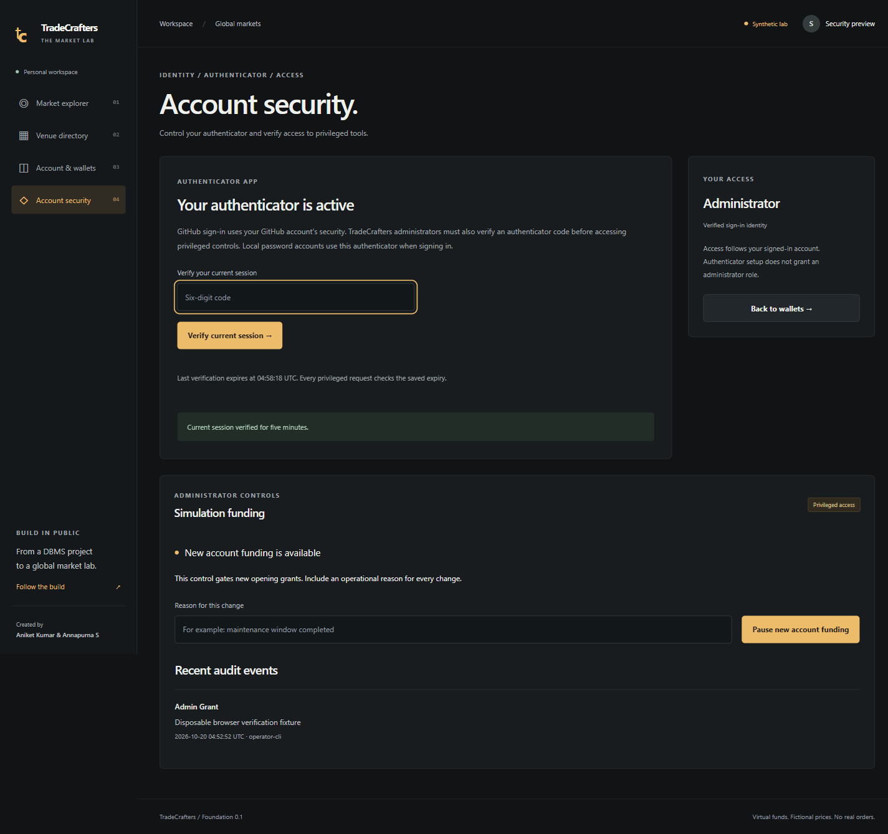
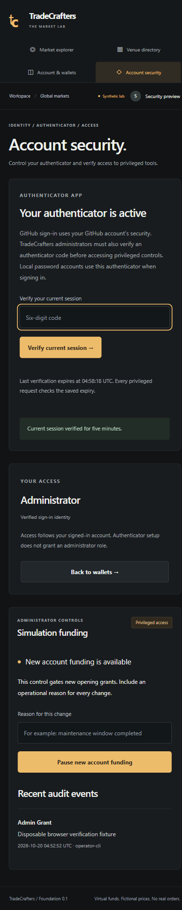

# Security slice verification — 20 October 2026

Environment: Node **24.22.0**, real Docker MySQL **8.4**, Next.js development server on `http://127.0.0.1:3000`. No public deployment or real market-data provider participated.

## HTTP and database evidence

The expanded integration suite passes **19/19** checks with real HTTP and MySQL. It retains the original 11 account/directory checks and adds eight security checks:

- Unverified members and verified members without a factor cannot bootstrap a role; forged HTTP role claims are denied. SQL predicate results are compared numerically because the driver can return `EXISTS` as the string `"0"`.
- An incorrect enrollment code fails, a correct standard TOTP code succeeds, and enrollment rotates the session. The old session is rejected. Setup does not grant administrator access.
- An explicit operator grant still requires a fresh authenticator proof. Reusing the same code is rejected; a different browser session has no proof.
- A pause records its reason, rejects a new opening grant, then a resume permits exactly one KWD grant of `30000000` minor units.
- Expired proof rejects both reads and writes. Old sign-in sessions cannot change MFA settings, and role revocation takes effect immediately.
- Local password sign-in returns a second-factor challenge. Its pending cookie cannot read an account. A recovery code completes sign-in once and fails on reuse.
- Authenticated verification attempts exhaust a persistent per-user budget and receive `429`.
- Disabling a factor clears saved privileged proofs from every session belonging to that identity, preventing old proofs from surviving factor replacement.

The test harness creates disposable random local identities and removes only its own records. It restores the funding control after testing. Fixture-only SQL verification flags are not exposed by the application. Test output does not print cookies, provisioning keys or recovery codes.

## Owner-assisted OAuth verification

The owner entered GitHub application credentials directly into ignored local configuration. Both required files were synchronized without printing their values. **Continue with GitHub** reached the registered application, the owner completed authorization, and the browser returned to `/account` showing **Aniket Kumar / Verified provider identity**. Reload retained the authenticated account. Public HTTPS callback behavior remains unverified.

## Browser and build checks

Using a separate disposable local identity, the browser completed password confirmation, QR enrollment, recovery-code acknowledgement and authenticator verification. After an explicit fixture operator grant, a fresh code unlocked the real administrator API and rendered the saved funding control and audit event. The owner account was not promoted by this test.

The security page was visually inspected at **390×844** and **1440×1050**; content stays within the viewport and mobile navigation uses four links across two rows. Final browser console: **0 errors / 0 warnings**. Type checking, lint, formatting, 8 domain tests and production compilation pass locally. The root workspace dependency audit reports **0 vulnerabilities**; legacy lockfiles remain separate.

These screenshots show the disposable administrator fixture, with provisioning/recovery secrets and code inputs absent:

## Scope limits

These checks demonstrate the listed local boundaries. They are not a penetration test or a public load/availability assessment. Production database privilege separation, external audit retention, provider recovery, lost-authenticator support and hosted deployment remain open. The [foundation verification](verification.md) records the earlier slice separately.
