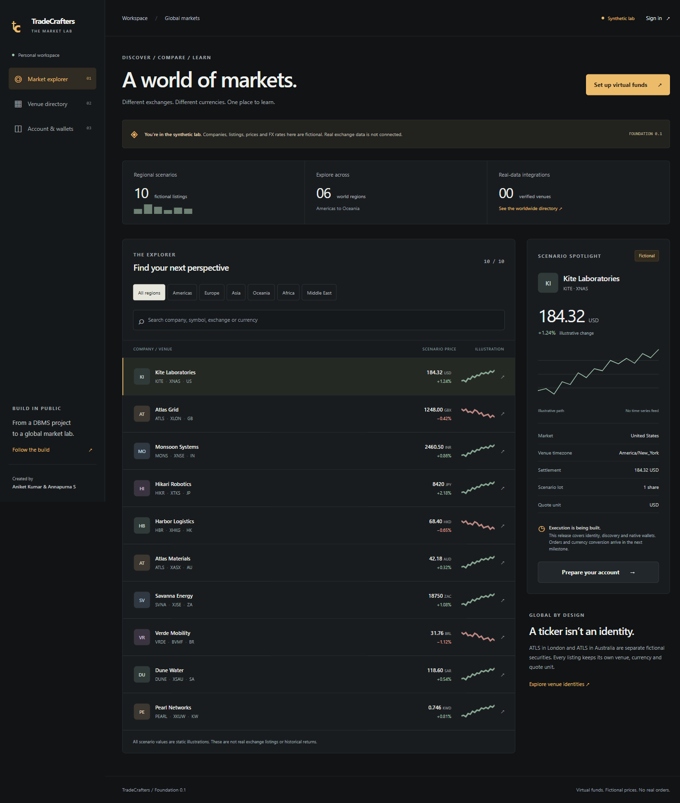
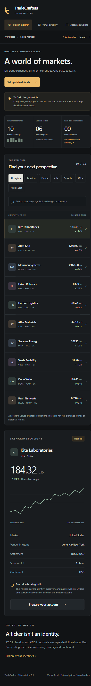

# Foundation verification — 20 October 2026

This records the initial foundation slice. See [M1 acceptance](m1-acceptance.md) for the later 80-check suite, catalog/alias/FX contracts, identity failure checks, restricted web database identity and current browser evidence. Counts below preserve the original slice's verification history.

**Story:** a visitor explores fictional listings across regions, searches a MySQL-backed worldwide MIC reference, signs in locally, creates one native-currency simulation account, adds an empty wallet, reloads saved balances, and signs out with immediate session revocation.

## Verified locally

Environment: Windows, **Node 24.22.0**, Next 16.4.2 and real **MySQL 8.4** in Docker (localhost only). The host's unrelated Node 25 was not the acceptance runtime. No cloud deployment or external market feed participated.

| Boundary / check               | Result and evidence                                                                                                                                                                                                                                                        |
| ------------------------------ | -------------------------------------------------------------------------------------------------------------------------------------------------------------------------------------------------------------------------------------------------------------------------- |
| Clean schema → app             | Both checked-in SQL migrations apply; 2,889 MIC records and ten fictional scenarios seed. Repeated migration/seed succeeds without changing user funding. Checksums normalize BOM/line endings for Windows/Linux consistency.                                              |
| Static checks                  | `npm run typecheck`, `npm run lint`, `npm run format:check` pass. Framework route types are generated before type checking.                                                                                                                                                |
| Domain rules                   | **8/8** `npm test` checks pass: exact amounts beyond JS Number precision, JPY/KWD exponents, GBX quote conversion, grant provenance, strict ownership-free inputs, DST/breaks/holidays/Sunday fixture sessions and ambiguous ticker identity.                              |
| HTTP → session → MySQL         | **11/11** `npm run test:integration` checks pass with real HTTP and MySQL, including forged/absent sessions, CSRF, malformed/oversized input, owner isolation, SQL search, default-deny capabilities, persistent rate budgets and sign-out revocation.                     |
| Concurrent funding             | Eight simultaneous account POSTs return the same account. One grant journal, two entries and zero journal net. JPY balance is exactly `15000000` minor units.                                                                                                              |
| Wallet funding                 | Added KWD wallet remains `0`, repeated addition remains one wallet, and account retry retains original reporting currency/grant.                                                                                                                                           |
| Fresh connection timezone      | A newly created pool reports `@@session.time_zone = '+00:00'`. The driver serialization timezone and DB session timezone are both set.                                                                                                                                     |
| Production compilation         | `npm run build` completes with dynamic app/API routes and standalone output. Production configuration rejects local password mode and missing HTTPS/OAuth. Actual production OAuth login is still unverified.                                                              |
| New workspace dependency audit | `npm audit --audit-level=high`: **0 vulnerabilities** at verification. Legacy client/server lockfiles are not included in this new workspace audit and their documented issues remain.                                                                                     |
| Browser → account → reload     | Local test account created through the form; selected INR, received `8,300,000.00` fictional funds, added KWD `0.000`, reloaded and saw both saved wallets. Sign-out returned to sign-in.                                                                                  |
| Browser global identity/units  | Asia filter displays three scenarios; ATLS search distinguishes XLON/XASX. Atlas Grid detail shows `1248.00 GBX` and settlement `12.48 GBP`.                                                                                                                               |
| Browser directory              | Country IN + segment filter submits a shareable URL and renders matching SQL-backed records. The worldwide reference displays snapshot/effective-date and unknown-rights disclosures.                                                                                      |
| Responsive / keyboard          | Browser inspected at **390×844, 768×1024 and 1440×1050**. Document width stays within viewport; directory table scrolls within its container. First Tab focuses “Skip to content”; labeled inputs, pressed-state region/listing controls and live form status are present. |
| Browser console                | Final explorer and filtered-directory checks show **0 errors / 0 warnings**. Initial favicon 404 was fixed by adding the app icon.                                                                                                                                         |

An auth-body wrapper initially failed because it reconstructed a consumed Request; it now reconstructs from URL/method/headers with the bounded body, and the full sign-up/session checks pass. A raw-versus-promise connection-event difference was caught with a fresh-pool check and fixed using the driver's underlying connection event. These checks cover the repaired boundaries.

## Screenshots

These show the running implementation with fictional data, not the earlier standalone design study.

## Limits

No claim of a complete accessibility audit, observed student walkthroughs, public load testing, backup restore, cloud deployment or real-data entitlement verification. Browser checks were performed locally through Playwright CLI; CI automates type/lint/format/domain/build/HTTP/MySQL checks, not those manual visual checks. GitHub Actions results are tracked on the implementation PR.

This record describes the first foundation slice. The subsequent [security verification record](security-verification.md) covers local owner-assisted GitHub OAuth, MFA/roles and funding controls; the [market-policy record](market-policies.md) covers versioned fictional calendars/rules and expands the combined suite to 43 checks. A production HTTPS callback, reviewed real venue calendars/rules, effective-dated cash-equity inventory, trading/FX/positions/receipts and deployment hardening remain open. Historical credential rotation was not tested or performed through the application. See [status and open gates](foundation-status.md).
