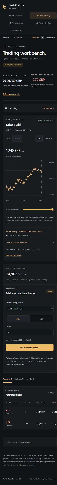

# M3 workbench implementation — 20 October 2026

The local `/trading` application now places venue-qualified discovery, an authored training chart, native cash and the order ticket in one workspace, with positions, Wallets & FX and activity below. This builds on the [M2 accounting contract](trading-accounting.md); financial posting, idempotency and reset semantics are unchanged.

**Implementation is ready for review; M3/#5 remains open for real student feedback.** The owner chose to defer the 3–5 observed walkthroughs. The [walkthrough script](../design/student-walkthrough.md) has blank participant records. Browser automation is engineering evidence and is not presented as student research or a WCAG certification.

## Discovery and selected context

- Fictional listings can be searched by company/symbol/MIC and filtered by region, country, settlement currency and exchange MIC. ATLS/XLON and ATLS/XASX remain separate securities and selections. Filters narrow discovery without silently changing the chart or submitted intent.
- Watchlist pins use listing IDs in an owner-scoped, versioned localStorage record, validated against the ten fixtures. They persist on that browser, contain no credentials or account balances, and are not synchronized to other devices. Invalid records are ignored; unavailable browser storage does not block trading.
- The capability selector also exposes the **worldwide real-venue reference**, with bounded search, country/MIC queries and pagination. Selecting a record shows its snapshot status, classification and missing coverage; it removes the order ticket and supplies no invented chart. `/trading?mic=XNYS` and directory links preserve that reference selection. All real trading remains disabled.
- Region/currency filters apply to the fictional listings whose metadata is known. The real MIC reference has no verified regional/trading-currency mapping or cash-equity denominator yet; these unknowns are disclosed rather than guessed. The full directory, including smaller/non-equity/expired records, remains available. This UI does not complete #9's worldwide inventory review.
- A selected listing keys its chart/ticket subtree; requests are aborted on context change. Old responses cannot replace the new listing's context. URL selection changes also remount the workspace. Market checks expire after 60 seconds; stale/failed checks disable order review while the market picker, other markets and account records remain accessible. Pending financial operations still block every new financial submission through M2's owner-scoped recovery record.

## Authored chart contract

`GET /api/listings/:listingId/chart` is a public, no-store, read-only Node route. The only optional query is `window=15m|60m` (default 60m). Unknown/repeated parameters, caller clocks/prices/modes and unbounded windows are rejected. Real/unknown identifiers return 404; unsupported mutation methods return 405.

The server validates the fictional listing metadata and its dated policy/permission. It resolves the same **20 October 2026, 10:15 venue-local** cutoff as M2. Current permission evidence is checked against actual server time. The response includes source/model/scenario, local timezone, market cutoff, actual check/expiry timestamps, eligibility/reason, next scheduled continuous session, rules and permitted points. It contains no account/session data and posts no quotes, orders or journals.

`authored-path-v1` is a deterministic project-written illustration, not observed price history or a provider feed. Its fixed shape varies by listing ID; the final point equals that listing's fixed M2 reference. All points precede or equal the server cutoff, use exact quote precision and allowed ticks/bands, and occur in continuous-session minutes. At most 61 points are returned. Short windows are suffixes of the same path, not newly generated histories. Auctions, holidays and breaks have no points; line segments do not bridge missing minute intervals.

The chart cannot rewind execution, choose a fill price or move the account clock. M2 orders still require a separate fresh account-bound server quote and all transaction-time checks. No volume, depth, indicators, live feed or portfolio performance curve is fabricated. Float conversion is limited to drawing coordinates/axis labels; order and series-price construction use exact integer arithmetic.

The chart offers a 15-minute/up-to-one-hour view, pointer and keyboard time inspection, plus a semantic exact-price table. Visible labels identify quote units, source, fixed clock, venue timezone, user timezone and actual rule-check age. The view distinguishes open/break/closed/halted/unavailable/stale checks. Scheduled next-session information is a calendar preview, not a promise that a halt or missing permission will be resolved then. All quote permissions and execution gates remain server-owned regardless of the browser clock.

## Account interactions

The selected ticket displays the listing's native wallet balance separately from reporting equity. Wallets & FX includes explicit conversion and source/time/rate/completeness details. Positions retain native quantities, basis and P&L. Activity filters the **loaded receipts** by trade, conversion, reset or decline; older pages can be loaded explicitly. This is not a claim of server-side history filtering across unseen pages.

New/opened receipts receive focus and announce their saved result. Native table overflow is contained and keyboard-scrollable. Mobile discovery collapses behind a named control and closes after selection; tablet uses a chart/ticket pair, while narrow screens use a single column. Changes preserve same-key unknown-response recovery, archived-history links and explicit reset confirmation.

## Verification evidence

The current suite contains **44 domain/configuration checks and 72 HTTP/MySQL integration checks (116 total)**. Six new domain checks cover regional chart precision/ticks/session/cutoff, deterministic window consistency, break/holiday omission, invalid bounds/references, identity-safe filters and next-session DST/coverage behavior. Two new HTTP checks cover all ten chart contexts and strict public endpoint boundaries. The M2 race/crash/FX/recovery suite remains included. Type/lint/format, source/credential patterns, audit and production compilation are part of the required CI job.

Chromium verification used a disposable fictional account, never the owner's credentials or authenticator:

- Distinct ATLS listings, currency filtering, pin persistence after reload, keyboard slider, 16-row 15m data table and deliberate keyboard order confirmation.
- Three ATLS/XLON shares settled 3,747 GBP minor units; explicit 5,000 GBP→937,500 JPY conversion funded a 100-share HIKR purchase at 842,500 JPY. Native cash, basis and reporting completeness refreshed from MySQL; activity reopened the original FX receipt and source.
- Real XNYS reference selection displayed missing coverage and no order ticket. Injected selected-market outage disabled review, and retry restored only that market. A browser-clock fixture exercised expiry without changing the server clock or account policy. These are controlled engineering fixtures, not actual feed incidents.
- Lost response after a committed fill, reload and receipt recovery produced one additional share and cleared the pending record without duplication.
- An unfunded AUD purchase returned a saved native-funds decline. A controlled break fixture disabled review and showed the next scheduled session; releasing an old delayed response after selecting another listing did not overwrite the new context. Reference and fictional-listing deep links opened the intended market.
- At widths 390/768/1280/1440, document widths equaled client widths 375/753/1265/1425 with scrollbars. Mobile discovery closes on selection; chart/positions tables scroll internally and the FX panel fits the page. A fresh non-injected page has no console errors/warnings.

QA found and fixed an ICU-dependent country-label hydration mismatch; fixture labels now match between Node and Chromium. The order picker also remains usable when a selected market is stale/unavailable. Injected failure fixtures produce their expected network errors and are excluded from the fresh-page console result.

## Remaining acceptance and operations

The [student protocol](../design/student-walkthrough.md) must be run with 3–5 real participants and resulting material friction addressed before M3 is accepted. Formal assistive-technology review and representative-device LCP/INP measurements are not claimed. Historical product-brief dollar amounts and administrator features are design examples; the implemented grant is the recorded 100,000 virtual USD-equivalent policy, and the admin pause controls new funding rather than all existing trading.

No new dependency, database migration, runtime grant, secret, paid service or cloud deployment is introduced. Restart development after workspace export-map changes if the bundler holds an old module graph. Production configuration and the [M2 rollback constraints](trading-accounting.md#upgrade-and-rollback) still apply. Hosted ingress/read-abuse controls, backup/restore, TLS/connection budgets and real HTTPS identity remain M4. Real feeds, rights and calendars remain M5/#9/M7; no real venue is enabled by this chart.
