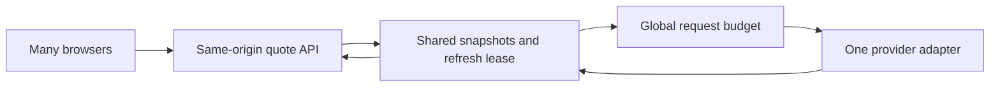

# Market-data strategy

Checked **20 October 2026**. Prices are USD list-price snapshots, exclude taxes and exchange add-ons, and must be rechecked before subscribing. No keys or paid subscriptions were created.

## Decision for this project

Use three explicitly separate modes:

1. **Public practice:** project-generated fictional instruments and synthetic prices. This is the dependable near-free demo and has no third-party stock-price quota. Label every quote/chart as synthetic; do not label invented values as AAPL/NSE market prices.
2. **Private US-equity development:** evaluate Alpaca's Basic data plan, subject to account eligibility and the permitted simulator use. Its IEX feed is a partial view of the US market. A server-side credential shared with public visitors is not automatically authorized by a personal plan.
3. **Public real-market mode:** enable only after written confirmation of simulator use, external display, historical storage/replay, audience, and exchange entitlements. First investigate Alpha Vantage's education/open-source program. If it does not fit, obtain Twelve Data and Alpaca business quotes. A delayed feed can be useful, but is still licensed data.

An account's mode, currency, provider, and feed are fixed for its lifetime. Switching mode creates another account. Never mix synthetic fills, IEX fills, and delayed consolidated prices into one performance record. Real history can be replayed publicly only where retention and redistribution permission covers that use.

## Provider comparison

| Candidate | Verified technical/pricing snapshot | Important limit or unresolved permission | Verdict for TradeCrafters |
| --- | --- | --- | --- |
| **Alpha Vantage** | Standard free access advertises **25 requests/day**. Support also advertises unlimited requests for **verified open-source or educational projects**. Real-time and 15-minute-delayed US data are premium entitlements. [Support](https://www.alphavantage.co/support/) | Program acceptance, eligible datasets, actual rate/burst policy, public display, simulator use, and storage must be confirmed. An unlimited quota is not itself a live-data entitlement. | Investigate first: the project's academic/open-source background may help. Keep it as an adapter; daily data can support research charts, not live fills. |
| **Alpaca Market Data** | Basic: **free, IEX real-time, 30 streaming symbols, 200 historical API calls/minute**. Algo Trader Plus: **$99/month**, wider US-exchange coverage, unlimited streaming symbols, 10,000 historical calls/minute. Basic historical access excludes the latest 15 minutes. [Plan comparison](https://docs.alpaca.markets/us/docs/about-market-data-api) | REST historical quota differs from streaming limits; recent-data restrictions differ by feed/endpoint. Confirm public display/redistribution and non-display simulation rights with Alpaca; individual subscription pricing is not a business quote. Account availability is a separate gate. | Strong private US-development candidate. Cap the initial real universe at 10 liquid equities. Do not describe IEX as consolidated NBBO or total market volume. |
| **Twelve Data** | Basic: **8 API credits/minute, 800/day**, trial streaming allocation. Business page advertises Venture from **$499/month** with external display access; plan-dependent credits and exchange add-ons. [Business pricing](https://twelvedata.com/pricing-business) | Credits are weighted by endpoint and symbol. Individual plans permit educational/development/internal uses but prohibit redistribution and commercial third-party display; business redistribution may require another agreement. [Usage policy](https://support.twelvedata.com/en/articles/5332349-commercial-and-personal-usage) | Useful provider adapter and a public-data procurement option. Its normal business price does not fit the owner's current budget. Educational terms require confirmation for a public simulator. |
| **Massive, formerly Polygon.io** | Individual stocks: free **5 calls/minute, end-of-day**; Starter **$29/month, 15-minute delayed**; Advanced **$199/month, real-time**. [Individual pricing](https://massive.com/pricing?product=stocks) | Individual plans are not the customer-facing licensing route. Business page lists **$2,499/month** for a derived Fair Market Value offering; exchange feeds and expanded rights can add costs. FMV is not an exchange bid/ask. [Business pricing](https://massive.com/business) | Good long-term technical option, poor fit for a near-free public app. A $29 individual plan is not a public-distribution workaround. |
| **Tiingo** | Offers REST, streaming, historical and derived feeds; personal versus commercial/redistribution offerings are separate. [Provider overview](https://www.tiingo.com/) | IEX TOPS access requires an exchange agreement; derived-reference-price access is a different product. A derived price is not a consolidated executable quote. [IEX documentation](https://www.tiingo.com/documentation/websockets/iex) | Request a narrow educational/derived-display quote if the first candidates fail. No numerical quota or universal public-use price is assumed here. |
| **Finnhub** | Official [pricing](https://finnhub.io/pricing) and [API rate-limit documentation](https://finnhub.io/docs/api/rate-limit) were investigated. Pricing was not reliably available in the research renderer. | Exact current plan quotas, feed scope, historical entitlements, and public-simulator rights remain unverified. Do not repeat third-party claims of a free quota as a procurement fact. | Secondary candidate, pending a verifiable current offer. Not the architecture's dependency. |

No provider is ranked as a universally free public live feed. Data rights are a product requirement that must match a concrete plan and use case.

## Indian markets: a separate release gate

**Do not use Kite Connect for this simulator.** Its [terms](https://kite.trade/terms/) expressly prohibit API/live-data use for virtual/mock trading applications and public display. This is stronger than a missing redistribution allowance.

[Upstox V3](https://upstox.com/developer/api-documentation/v3/get-market-data-feed/) provides authenticated Protobuf WebSocket data, but that capability does not establish authorization for this product. Keep it unapproved until the provider explicitly confirms simulator and audience rights.

NSE's [data-sharing policy](https://www.nseindia.com/static/market-data/nse-data-policy) requires agreement-defined use and redistribution. Its [20 April 2023 member circular](https://nsearchives.nseindia.com/content/circulars/COMP56426.pdf) specifically addresses misuse of member data for virtual trading. These documents are constraints to resolve with the exchange/provider, not a claim that every historical or separately licensed educational scenario is forbidden.

For phase two, seek an authorized vendor's written offering for delayed or historical educational simulation, covering **NSE and BSE separately**. Otherwise provide fictional INR scenarios. Add MIC/exchange identity, INR accounts, Asia/Kolkata market sessions, Indian holidays, tick/lot rules, corporate actions, and a versioned fee model. Do not scrape broker or exchange websites as the data architecture.

## Spend requests per symbol, not per visitor

For the real-data adapter, place the provider behind one server-side market-data boundary:

Initial design: at most 10 enabled real symbols, batch where supported, refresh a shared snapshot at a provider-appropriate interval **only while a user requests it**. Use an atomic database lease to avoid a cache stampede across function instances. Fetch outside financial transactions; store a normalized immutable snapshot afterward. No browser receives the provider key. No user can submit arbitrary upstream URLs or grow the symbol universe without a cap.

An illustrative calculation: 10 symbols fetched separately every 15 seconds over a 6.5-hour session need `10 × 4 × 390 = 15,600` provider calls/day. Ten visitors repeating that work independently need 156,000. A multi-symbol endpoint may reduce HTTP calls, but can still charge per-symbol credits. Against Alpha Vantage's normal 25/day or Twelve Data Basic's 800 credits/day, caching alone cannot create a continuous 10-symbol feed. Choose a longer refresh period, smaller universe, streaming entitlement, grant, or synthetic mode.

The browser refresh interval is independent of the upstream interval. One batched request per 15 seconds is enough for an early demo; pause when hidden, back off on failures, and invalidate account state immediately after a fill. Show actual timestamps instead of implying tick-by-tick streaming.

Later, if entitled streaming is useful, deploy a single active ingest worker with a renewable leader lease. It reconnects with jitter, deduplicates events, detects gaps, and backfills within entitlement. The browser still reads normalized data through TradeCrafters. Never allocate a provider socket per visitor.

## Quote contract and failure policy

Every snapshot carries `instrumentId`, `provider`, `feed`, `coverage`, `currency`, `sourceTime`, `receivedAt`, `mode`, `expectedDelaySeconds`, `marketState`, `bid`, `ask`, `last`, and a stable `snapshotId`. Numeric prices are decimal strings. Missing bid/ask are null, never zero. Bars separately declare interval, timezone, and raw/adjusted status.

| Situation | Display | Execution |
| --- | --- | --- |
| Eligible real-time snapshot | Venue/feed label and age | Use the account's versioned fill policy |
| Intentionally delayed feed | Prominent delay and source time | In a future delayed mode, advance a separate market clock; never compete against real-time accounts |
| Stale, throttled, disconnected, malformed, or future-dated | Last value with stale/error label, or unavailable | Fail closed with a specific reason; do not fill at the last cached close |
| Market closed or instrument halted | Explicit session/halt state | Reject MVP market orders; queued opening orders need later semantics |
| Synthetic scenario | Persistent synthetic label and scenario clock | Server-generated price using the same scenario clock, with no third-party claim |

Provider switching is an explicit operator action. Disable trading during a feed change, validate units/calendar/adjustment policy, and create new accounts where comparability changes. Silent fallback across providers can alter execution and P&L.

## Questions to resolve before enabling a real feed

Prepare this use-case description for provider support; no messages were sent during research:

- Open-source, non-commercial US-stock simulator, initially 10 instruments and a small public audience; no real-money order routing.
- Are public visitor display, simulated execution/non-display use, and account P&L calculations permitted? Are anonymous visitors and authenticated users treated differently?
- What are the exact feed, venues, latency, endpoint quotas, streaming caps, and user/exchange declarations?
- Can prices/bars be cached, stored, exported, replayed, or retained inside fill receipts? What retention, deletion, and attribution obligations apply?
- Does educational status cover a public portfolio demo? What happens after graduation or if the app becomes commercial?
- For India, is virtual trading explicitly permitted by the applicable vendor and exchange agreements?

Record the written answer, plan, scope, expiry/review date, and restrictions in a private entitlement register. Only a non-sensitive approval summary belongs in the public repository.
